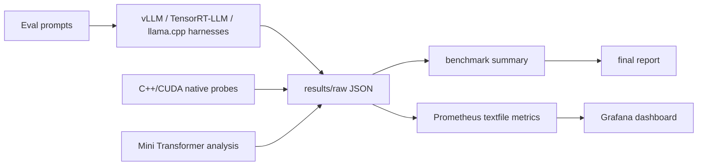

# InferLab Final Report

- Generated: `2026-08-09T11:18:08Z`
- Results root: `path_9722b9c7e20437e7`

## Executive Summary

InferLab is a cloud plus edge LLM inference optimization lab. It connects Mini Transformer references, native C++/CUDA primitives, KV/PagedAttention scheduling, quantization/GGUF parsing, vLLM/TensorRT-LLM serving harnesses, llama.cpp edge benchmarking, Android deployment scaffolding, and Prometheus/Grafana observability.

The report is generated from repository artifacts. Missing runtime evidence is listed explicitly so later GPU, serving, Android, and monitoring machines can fill the remaining data without changing the report structure.

## Architecture



## Module Coverage

| Module | Why it matters | Code | Notes | Report | Results | Probe Fail |
|---|---|---:|---:|---:|---:|---:|
| Mini Transformer and KV Cache | Explains prefill/decode shape flow, cached decode, and recompute avoidance. | yes | no | no | 5/5 | 0 |
| Native KV, PagedAttention, and Scheduler | Connects KV allocation, block tables, queueing, TTFT-style latency, and serving throughput. | no | no | yes | 5/5 | 0 |
| CUDA Kernels | Shows bottom-up operator implementation and where GPU profiling should be attached. | yes | no | yes | 3/4 | 0 |
| Quantization and GGUF | Explains storage layout, block dequantization, metadata overhead, and low-bit trade-offs. | yes | no | yes | 3/3 | 0 |
| Cloud Serving | Compares online serving, OpenAI-compatible endpoints, scheduler behavior, and monitoring. | yes | yes | no | 2/2 | 0 |
| Edge llama.cpp and Android | Covers GGUF runtime, CPU/ARM deployment, simpleperf/perf hooks, and device constraints. | yes | yes | yes | 2/4 | 0 |
| Runtime, Observability, and Reproducibility | Makes results reproducible and explainable across CPU, GPU, and monitoring machines. | yes | yes | yes | 6/7 | 0 |
| Backend Quality Evaluation | Keeps optimization tied to fixed-prompt correctness checks and cross-backend output comparison. | yes | no | yes | 0/1 | 0 |
| Backend Comparison | Turns cloud, compiled GPU, edge GGUF, native, profiling, quality, and cost artifacts into one trade-off table. | yes | no | yes | 0/1 | 0 |
| Advanced Serving Diagnostics and Plans | Connects mature serving products, dry-run plans, and local C++ diagnostic models without claiming to replace production vLLM, SGLang, TensorRT-LLM, TGI, llama.cpp, LMDeploy, KServe, or Dynamo internals. | yes | yes | yes | 54/125 | 0 |
| Mature Product Profiles | Uses mature inference products as real backends, then captures preflight, version, config, metrics, and report evidence without reimplementing product cores. | yes | yes | yes | 2/18 | 0 |
| Evidence Governance And High-Value Engineering | Turns raw artifacts into queryable lineage, release blocker root causes, dependency governance, kernel microbenchmark manifests, and product replay semantic correlations. | yes | yes | yes | 37/37 | 0 |

## Benchmark Summary

| Section | Source | Status | Confidence | Metric count | Selected metrics |
|---|---|---:|---:|---:|---|
| System | `system_info.json` | `ok` | `stale_or_blocked` | 6 | evidence_confidence=stale_or_blocked |
| CUDA Preflight | `cuda_environment.json` | `ok` | `stale_or_blocked` | 7 | cuda_available=False, evidence_confidence=stale_or_blocked |
| vLLM Serving Benchmark | `vllm_serving_benchmark.json` | `ok` | `schema_only` | 19 | status=skipped, mode=preflight_only, model=TinyLlama/TinyLlama-1.1B-Chat-v1.0, vllm_available=False, gpu_available=False, avg_latency_ms=None |
| llama.cpp Edge Benchmark | `llama_cpp_benchmark.json` | `ok` | `schema_only` | 25 | status=skipped, mode=auto, model=, prompt_eval_tokens=None, prompt_eval_tokens_per_s=None, eval_tokens=None |
| TensorRT-LLM Benchmark | `trtllm_benchmark.json` | `ok` | `schema_only` | 30 | status=skipped, mode=preflight, requested_mode=auto, model=, tensorrt_llm_available=False, tensorrt_available=False |
| Native Probe Runner | `native_probe_run.json` | `ok` | `schema_only` | 12 | evidence_confidence=schema_only |
| Python Shape Probe | `shape_probe.json` | `ok` | `stale_or_blocked` | 9 | evidence_confidence=stale_or_blocked |
| Mini Transformer Cache Compare | `mini_transformer_cache_compare.json` | `ok` | `schema_only` | 18 | prompt_tokens=3, max_new_tokens=4, cached_input_tokens=7, recompute_input_tokens=25, cached_max_kv_cache_total_bytes=7168, recompute_max_kv_cache_total_bytes=0 |
| Mini Transformer Workload Profile | `mini_transformer_workload_profile.json` | `ok` | `schema_only` | 20 | prompt_tokens=128, max_new_tokens=16, dtype_bytes=4, cached_total_bytes=6734336, recompute_total_bytes=35538432, bytes_saved=28804096 |
| Mini Transformer Bottleneck Advisor | `mini_transformer_bottleneck_advisor.json` | `ok` | `schema_only` | 19 | prompt_tokens=128, max_new_tokens=16, evidence_confidence=schema_only |
| Mini Transformer Scenario Sweep | `mini_transformer_scenario_sweep.json` | `ok` | `schema_only` | 16 | top_bytes_saved_scenario=long_context, top_bytes_saved_percent=86.7247, top_persistent_kv_bytes=253952, evidence_confidence=schema_only |
| Speculative Decode Probe | `speculative_decode_probe.json` | `ok` | `schema_only` | 15 | output_tokens=128, evidence_confidence=schema_only |
| Native Shape Probe | `native_shape_probe.json` | `ok` | `stale_or_blocked` | 9 | evidence_confidence=stale_or_blocked |
| Continuous Batching | `scheduler_trace.json` | `ok` | `stale_or_blocked` | 32 | total_decoded_tokens=9, peak_reserved_bytes=3072, pressure_peak_reserved_bytes=3072, pressure_peak_total_tokens=17, pressure_tokens_per_step=1.5, evidence_confidence=stale_or_blocked |
| Scheduler Pressure Sweep | `scheduler_pressure_sweep.json` | `ok` | `stale_or_blocked` | 32 | best_tokens_per_step_scenario=wide_batch, best_tokens_per_step=2.333333, serial_latency_tokens_per_step=1.0, serial_latency_average_ttft_steps=6.6, serial_latency_peak_used_blocks=2, serial_latency_peak_cache_utilization=1.0 |
| Scheduler Workload Sweep | `scheduler_workload_sweep.json` | `ok` | `stale_or_blocked` | 47 | config_block_size_tokens=8, best_tokens_per_step_workload=prefill_heavy, best_tokens_per_step=3.0, short_chat_tokens_per_step=2.666667, decode_heavy_tokens_per_step=2.727273, prefill_heavy_tokens_per_step=3.0 |
| Scheduler Capacity Sweep | `scheduler_capacity_sweep.json` | `ok` | `stale_or_blocked` | 56 | config_block_size_tokens=8, minimum_no_rejection_tokens_per_step=2.666667, best_no_rejection_tokens_per_step=2.666667, highest_tokens_per_step_blocks=11, highest_tokens_per_step=2.666667, blocks_3_tokens_per_step=0.0 |
| Scheduler Admission Policy Sweep | `scheduler_admission_policy_sweep.json` | `ok` | `stale_or_blocked` | 46 | config_block_size_tokens=8, best_tokens_per_step_policy=short_total_first, best_tokens_per_step=2.75, fcfs_tokens_per_step=2.3, short_total_first_tokens_per_step=2.75, short_prompt_first_tokens_per_step=2.75 |
| Scheduler Runtime Policy Sweep | `scheduler_runtime_policy_sweep.json` | `ok` | `stale_or_blocked` | 67 | config_block_size_tokens=4, best_tokens_per_step_policy=reject_on_pressure, best_tokens_per_step=1.857143, total_recompute_tokens=25, reject_on_pressure_tokens_per_step=1.857143, reject_on_pressure_total_recompute_tokens=0 |
| Scheduler Fairness Sweep | `scheduler_fairness_sweep.json` | `ok` | `stale_or_blocked` | 73 | config_block_size_tokens=4, best_tokens_per_step_policy=fcfs, best_tokens_per_step=1.9, fcfs_tokens_per_step=1.9, shortest_decode_first_tokens_per_step=1.9, longest_decode_first_tokens_per_step=1.9 |
| Static vs Paged KV | `kv_allocation_compare.json` | `ok` | `stale_or_blocked` | 7 | static_reserved_bytes=32768, paged_reserved_bytes=9216, reserved_bytes_saved=23552, evidence_confidence=stale_or_blocked |
| Prefix Cache Sharing | `prefix_cache_compare.json` | `ok` | `stale_or_blocked` | 13 | no_prefix_reserved_bytes=12288, shared_prefix_reserved_bytes=6144, reserved_bytes_saved=6144, traffic_no_prefix_prefill_write_bytes=12288, traffic_shared_prefix_prefill_write_bytes=6144, traffic_prefix_write_bytes_saved=6144 |
| Paged KV Fragmentation | `kv_fragmentation_probe.json` | `ok` | `stale_or_blocked` | 9 | block_size_tokens=4, evidence_confidence=stale_or_blocked |
| Paged KV Locality | `paged_kv_locality_probe.json` | `ok` | `stale_or_blocked` | 9 | evidence_confidence=stale_or_blocked |
| Weight-Only Quantization | `quantization_probe.json` | `ok` | `stale_or_blocked` | 9 | evidence_confidence=stale_or_blocked |
| INT4 Group Sweep | `quantization_sweep.json` | `ok` | `stale_or_blocked` | 6 | evidence_confidence=stale_or_blocked |
| Per-Channel vs Per-Group | `quantization_channel_compare.json` | `ok` | `stale_or_blocked` | 6 | evidence_confidence=stale_or_blocked |
| Attention Reference | `attention_probe.json` | `ok` | `stale_or_blocked` | 12 | query_length=4, non_causal_intermediate_bytes=384, evidence_confidence=stale_or_blocked |
| Matrix/Softmax Profile | `matrix_ops_profile.json` | `ok` | `stale_or_blocked` | 20 | matmul_compulsory_bytes=416, matmul_naive_loop_bytes=1632, tiled_matmul_global_bytes=736, matvec_naive_loop_bytes=272, softmax_total_memory_bytes=480, evidence_confidence=stale_or_blocked |
| Decoder Block | `decoder_probe.json` | `ok` | `stale_or_blocked` | 7 | evidence_confidence=stale_or_blocked |
| Decoder KV Decode | `decoder_kv_probe.json` | `ok` | `stale_or_blocked` | 16 | prompt_tokens=5, final_tokens=8, block_size_tokens=4, profile_final_logical_kv_bytes=1024, profile_final_reserved_kv_bytes=1024, profile_block_table_lookup_bytes=168 |
| GGUF Parser | `gguf_probe.json` | `ok` | `schema_only` | 253 | file_size_bytes=5536, fixture_size_bytes=5536, header_size_bytes=24, metadata_size_bytes=338, tensor_info_size_bytes=1638, tensor_data_padding_bytes=16 |
| GGUF Fixture Comparison | `gguf_fixture_comparison.json` | `missing` | `stale_or_blocked` | 2 | status=missing source file, evidence_confidence=stale_or_blocked |
| Final Report Index | `final_report_index.json` | `ok` | `schema_only` | 1050 | catalog_drift_registry_decision=all_catalog_surfaces_consuming_registry, catalog_drift_decision=no_static_catalog_gap_detected, single_source_parity_decision=None, single_source_parity_repair_card_count=None, fallback_removal_parity_gate_decision=None, fallback_removal_parity_gate_blocker_count=None |
| Backend Quality Evaluation | `backend_quality_eval.json` | `missing` | `stale_or_blocked` | 2 | status=missing source file, evidence_confidence=stale_or_blocked |
| Profiling Artifacts | `profiling_artifacts.json` | `missing` | `stale_or_blocked` | 2 | status=missing source file, evidence_confidence=stale_or_blocked |
| Backend Comparison | `backend_comparison.json` | `missing` | `stale_or_blocked` | 2 | status=missing source file, evidence_confidence=stale_or_blocked |
| CUDA Profiling Matrix | `cuda_profile_matrix.json` | `missing` | `stale_or_blocked` | 2 | status=missing source file, evidence_confidence=stale_or_blocked |
| llama.cpp Matrix | `llama_cpp_matrix.json` | `missing` | `stale_or_blocked` | 2 | status=missing source file, evidence_confidence=stale_or_blocked |
| Android Edge Benchmark | `android_edge_benchmark.json` | `missing` | `stale_or_blocked` | 2 | status=missing source file, evidence_confidence=stale_or_blocked |
| Source Trace Verification | `source_trace_verification.json` | `ok` | `schema_only` | 12 | status=planned, executed=None, evidence_confidence=schema_only |
| Evidence Checklist | `evidence_checklist.json` | `ok` | `schema_only` | 12 | status=open, executed=None, evidence_confidence=schema_only |
| Structured Outputs | `structured_outputs.json` | `missing` | `stale_or_blocked` | 2 | status=missing source file, evidence_confidence=stale_or_blocked |
| Lora Matrix | `lora_matrix.json` | `missing` | `stale_or_blocked` | 2 | status=missing source file, evidence_confidence=stale_or_blocked |
| Kv Aware Router | `kv_aware_router.json` | `missing` | `stale_or_blocked` | 2 | status=missing source file, evidence_confidence=stale_or_blocked |
| Disaggregated Serving | `disaggregated_serving.json` | `missing` | `stale_or_blocked` | 2 | status=missing source file, evidence_confidence=stale_or_blocked |
| Long Context Matrix | `long_context_matrix.json` | `missing` | `stale_or_blocked` | 2 | status=missing source file, evidence_confidence=stale_or_blocked |
| Pooling Benchmark | `pooling_benchmark.json` | `missing` | `stale_or_blocked` | 2 | status=missing source file, evidence_confidence=stale_or_blocked |
| Multimodal Plan | `multimodal_plan.json` | `missing` | `stale_or_blocked` | 2 | status=missing source file, evidence_confidence=stale_or_blocked |
| Kv Tier Simulator | `kv_tier_simulator.json` | `missing` | `stale_or_blocked` | 2 | status=missing source file, evidence_confidence=stale_or_blocked |
| Slo Capacity Plan | `slo_capacity_plan.json` | `missing` | `stale_or_blocked` | 2 | status=missing source file, evidence_confidence=stale_or_blocked |
| Kserve Llm D Plan | `kserve_llm_d_plan.json` | `missing` | `stale_or_blocked` | 2 | status=missing source file, evidence_confidence=stale_or_blocked |
| Moe Expert Parallel | `moe_expert_parallel.json` | `missing` | `stale_or_blocked` | 2 | status=missing source file, evidence_confidence=stale_or_blocked |
| Low Precision Runtime Plan | `low_precision_runtime_plan.json` | `missing` | `stale_or_blocked` | 2 | status=missing source file, evidence_confidence=stale_or_blocked |
| Semantic Cache Simulator | `semantic_cache_simulator.json` | `missing` | `stale_or_blocked` | 2 | status=missing source file, evidence_confidence=stale_or_blocked |
| Session Cache Simulator | `session_cache_simulator.json` | `missing` | `stale_or_blocked` | 2 | status=missing source file, evidence_confidence=stale_or_blocked |
| Multi Model Router | `multi_model_router.json` | `missing` | `stale_or_blocked` | 2 | status=missing source file, evidence_confidence=stale_or_blocked |
| Native Advanced Kv Router | `native_advanced_kv_router.json` | `ok` | `stale_or_blocked` | 18 | status=ok, mode=dry_run, artifact_type=native_advanced_kv_router, executed=False, claim_scope=Request-level KV-aware routing artifact is a compiled deterministic local simulation with an optional explicitly supplied trace projection. It anonymizes req..., evidence_confidence=stale_or_blocked |
| Native Disaggregated Serving | `native_disaggregated_serving.json` | `missing` | `stale_or_blocked` | 2 | status=missing source file, evidence_confidence=stale_or_blocked |
| Native Slo Capacity Plan | `native_slo_capacity_plan.json` | `missing` | `stale_or_blocked` | 2 | status=missing source file, evidence_confidence=stale_or_blocked |
| Native Structured Outputs | `native_structured_outputs.json` | `missing` | `stale_or_blocked` | 2 | status=missing source file, evidence_confidence=stale_or_blocked |
| Native Lora Matrix | `native_lora_matrix.json` | `missing` | `stale_or_blocked` | 2 | status=missing source file, evidence_confidence=stale_or_blocked |
| Native Long Context Matrix | `native_long_context_matrix.json` | `missing` | `stale_or_blocked` | 2 | status=missing source file, evidence_confidence=stale_or_blocked |
| Native Pooling Benchmark | `native_pooling_benchmark.json` | `missing` | `stale_or_blocked` | 2 | status=missing source file, evidence_confidence=stale_or_blocked |
| Native Rag Pooling Cache Plan | `native_rag_pooling_cache_plan.json` | `missing` | `stale_or_blocked` | 2 | status=missing source file, evidence_confidence=stale_or_blocked |
| Native Kv Tier Simulator | `native_kv_tier_simulator.json` | `missing` | `stale_or_blocked` | 2 | status=missing source file, evidence_confidence=stale_or_blocked |
| Native Kv Tier Eviction Plan | `native_kv_tier_eviction_plan.json` | `missing` | `stale_or_blocked` | 2 | status=missing source file, evidence_confidence=stale_or_blocked |
| Native Semantic Cache Simulator | `native_semantic_cache_simulator.json` | `missing` | `stale_or_blocked` | 2 | status=missing source file, evidence_confidence=stale_or_blocked |
| Native Multi Model Router | `native_multi_model_router.json` | `missing` | `stale_or_blocked` | 2 | status=missing source file, evidence_confidence=stale_or_blocked |
| Native Session Cache Simulator | `native_session_cache_simulator.json` | `missing` | `stale_or_blocked` | 2 | status=missing source file, evidence_confidence=stale_or_blocked |
| Native Low Precision Runtime Plan | `native_low_precision_runtime_plan.json` | `missing` | `stale_or_blocked` | 2 | status=missing source file, evidence_confidence=stale_or_blocked |
| Native Speculative Decode Plan | `native_speculative_decode_plan.json` | `missing` | `stale_or_blocked` | 2 | status=missing source file, evidence_confidence=stale_or_blocked |
| Native Moe Expert Parallel | `native_moe_expert_parallel.json` | `missing` | `stale_or_blocked` | 2 | status=missing source file, evidence_confidence=stale_or_blocked |
| Native Multimodal Plan | `native_multimodal_plan.json` | `missing` | `stale_or_blocked` | 2 | status=missing source file, evidence_confidence=stale_or_blocked |
| Native Multimodal Fusion Cache Plan | `native_multimodal_fusion_cache_plan.json` | `missing` | `stale_or_blocked` | 2 | status=missing source file, evidence_confidence=stale_or_blocked |
| Native Admission Control Plan | `native_admission_control_plan.json` | `missing` | `stale_or_blocked` | 2 | status=missing source file, evidence_confidence=stale_or_blocked |
| Native Autoscaling Plan | `native_autoscaling_plan.json` | `missing` | `stale_or_blocked` | 2 | status=missing source file, evidence_confidence=stale_or_blocked |
| Native Observability Slo Plan | `native_observability_slo_plan.json` | `missing` | `stale_or_blocked` | 2 | status=missing source file, evidence_confidence=stale_or_blocked |
| Native Otel Trace Plan | `native_otel_trace_plan.json` | `missing` | `stale_or_blocked` | 2 | status=missing source file, evidence_confidence=stale_or_blocked |
| Native Backend Feature Matrix | `native_backend_feature_matrix.json` | `missing` | `stale_or_blocked` | 2 | status=missing source file, evidence_confidence=stale_or_blocked |
| Native Tool Call Parser Plan | `native_tool_call_parser_plan.json` | `missing` | `stale_or_blocked` | 2 | status=missing source file, evidence_confidence=stale_or_blocked |
| Native Streaming Sse Plan | `native_streaming_sse_plan.json` | `ok` | `dry_run_ready` | 18 | status=ok, mode=dry_run_plan, artifact_type=None, executed=False, claim_scope=native streaming/SSE planning artifact only; does not run benchmarks, external products, or target-environment execution, evidence_confidence=dry_run_ready |
| Native Backend Adapter Plan | `native_backend_adapter_plan.json` | `missing` | `stale_or_blocked` | 2 | status=missing source file, evidence_confidence=stale_or_blocked |
| Native Server Endpoint Benchmark Plan | `native_server_endpoint_benchmark_plan.json` | `missing` | `stale_or_blocked` | 2 | status=missing source file, evidence_confidence=stale_or_blocked |
| Native Engine Artifact Plan | `native_engine_artifact_plan.json` | `missing` | `stale_or_blocked` | 2 | status=missing source file, evidence_confidence=stale_or_blocked |
| Native Edge Cpu Policy Plan | `native_edge_cpu_policy_plan.json` | `missing` | `stale_or_blocked` | 2 | status=missing source file, evidence_confidence=stale_or_blocked |
| Native Kv Cache Quant Plan | `native_kv_cache_quant_plan.json` | `missing` | `stale_or_blocked` | 2 | status=missing source file, evidence_confidence=stale_or_blocked |
| Native Dynamic Split Fuse Plan | `native_dynamic_split_fuse_plan.json` | `missing` | `stale_or_blocked` | 2 | status=missing source file, evidence_confidence=stale_or_blocked |
| Native Radix Prefix Cache Plan | `native_radix_prefix_cache_plan.json` | `missing` | `stale_or_blocked` | 2 | status=missing source file, evidence_confidence=stale_or_blocked |
| Native Cuda Graph Replay Plan | `native_cuda_graph_replay_plan.json` | `missing` | `stale_or_blocked` | 2 | status=missing source file, evidence_confidence=stale_or_blocked |
| Native Paged Attention Kernel Plan | `native_paged_attention_kernel_plan.json` | `missing` | `stale_or_blocked` | 2 | status=missing source file, evidence_confidence=stale_or_blocked |
| Native Kv Transfer Fabric Plan | `native_kv_transfer_fabric_plan.json` | `missing` | `stale_or_blocked` | 2 | status=missing source file, evidence_confidence=stale_or_blocked |
| Native Continuous Batching Plan | `native_continuous_batching_plan.json` | `missing` | `stale_or_blocked` | 2 | status=missing source file, evidence_confidence=stale_or_blocked |
| Native Tensor Parallel Comm Plan | `native_tensor_parallel_comm_plan.json` | `missing` | `stale_or_blocked` | 2 | status=missing source file, evidence_confidence=stale_or_blocked |
| Native Kserve Llmd Manifest Plan | `native_kserve_llmd_manifest_plan.json` | `missing` | `stale_or_blocked` | 2 | status=missing source file, evidence_confidence=stale_or_blocked |
| Native Otel Sampling Budget Plan | `native_otel_sampling_budget_plan.json` | `missing` | `stale_or_blocked` | 2 | status=missing source file, evidence_confidence=stale_or_blocked |
| Native Moe Hot Expert Plan | `native_moe_hot_expert_plan.json` | `missing` | `stale_or_blocked` | 2 | status=missing source file, evidence_confidence=stale_or_blocked |
| Native Lora Adapter Cache Plan | `native_lora_adapter_cache_plan.json` | `missing` | `stale_or_blocked` | 2 | status=missing source file, evidence_confidence=stale_or_blocked |
| Native Structured Grammar Pressure Plan | `native_structured_grammar_pressure_plan.json` | `missing` | `stale_or_blocked` | 2 | status=missing source file, evidence_confidence=stale_or_blocked |
| Native Chunked Prefill Scheduler Plan | `native_chunked_prefill_scheduler_plan.json` | `missing` | `stale_or_blocked` | 2 | status=missing source file, evidence_confidence=stale_or_blocked |
| Native Rate Limit Plan | `native_rate_limit_plan.json` | `missing` | `stale_or_blocked` | 2 | status=missing source file, evidence_confidence=stale_or_blocked |
| Native Canary Rollout Plan | `native_canary_rollout_plan.json` | `missing` | `stale_or_blocked` | 2 | status=missing source file, evidence_confidence=stale_or_blocked |
| Native Cost Accounting Plan | `native_cost_accounting_plan.json` | `missing` | `stale_or_blocked` | 2 | status=missing source file, evidence_confidence=stale_or_blocked |
| Native Kv Offload Hierarchy Plan | `native_kv_offload_hierarchy_plan.json` | `ok` | `dry_run_ready` | 18 | status=ok, mode=dry_run_plan, artifact_type=native_kv_offload_hierarchy_plan, executed=False, claim_scope=compiled KV offload hierarchy analytical fixture only; not live trace ingestion, runtime allocation/eviction, transport execution, product replay/execute, me..., evidence_confidence=dry_run_ready |
| Native Engine Memory Planner | `native_engine_memory_planner.json` | `ok` | `schema_only` | 18 | status=ok, mode=dry_run_plan, artifact_type=native_engine_memory_planner, executed=False, claim_scope=compiled analytical engine-memory fixture only; not observed allocator or CUDA memory, runtime admission, product backend capacity, OOM reproduction, benchma..., evidence_confidence=schema_only |
| Native Speculative Strategy Matrix | `native_speculative_strategy_matrix.json` | `ok` | `dry_run_ready` | 18 | status=ok, mode=dry_run, artifact_type=native_speculative_strategy_matrix, executed=False, claim_scope=Speculative strategy matrix is a compiled analytical fixture over the native reference estimator. It does not prove product strategy support, decode correctn..., evidence_confidence=dry_run_ready |
| Native Pd Transfer Overlap Plan | `native_pd_transfer_overlap_plan.json` | `ok` | `stale_or_blocked` | 18 | status=ok, mode=dry_run_plan, artifact_type=native_pd_transfer_overlap_plan, executed=False, claim_scope=PD transfer overlap artifact is a compiled multi-chunk prefill/decode analytical fixture with an optional explicitly supplied trace projection. It does not p..., evidence_confidence=stale_or_blocked |
| Native Lora Control Plane | `native_lora_control_plane.json` | `ok` | `dry_run_ready` | 18 | status=ok, mode=dry_run, artifact_type=native_lora_control_plane, executed=False, claim_scope=LoRA control-plane artifact is a compiled analytical fixture. It does not load adapters, query or mutate an adapter registry, observe cache residency, measur..., evidence_confidence=dry_run_ready |
| Native Queue Depth Autoscaler | `native_queue_depth_autoscaler.json` | `ok` | `dry_run_ready` | 18 | status=ok, mode=dry_run, artifact_type=native_queue_depth_autoscaler, executed=False, claim_scope=Queue-depth autoscaler artifact is a compiled analytical fixture. It does not observe a live queue or endpoint SLO, query GPU utilization, mutate replica sta..., evidence_confidence=dry_run_ready |
| Native Otel Span Budget | `native_otel_span_budget.json` | `ok` | `dry_run_ready` | 18 | status=ok, mode=dry_run, artifact_type=native_otel_span_budget, executed=False, claim_scope=OTel span-budget artifact is a compiled analytical fixture over static span schemas and explicit budget assumptions. It does not collect or export traces, in..., evidence_confidence=dry_run_ready |
| Native Heterogeneous Gpu Planner | `native_heterogeneous_gpu_planner.json` | `ok` | `dry_run_ready` | 18 | status=ok, mode=dry_run, artifact_type=native_heterogeneous_gpu_planner, executed=False, claim_scope=Heterogeneous GPU planner is a dry-run analytical placement model. GPU inventory, allocation, CUDA execution, measured timing/cost, and serving performance c..., evidence_confidence=dry_run_ready |
| Native Openai Api Conformance | `native_openai_api_conformance.json` | `ok` | `dry_run_ready` | 18 | status=ok, mode=dry_run, artifact_type=native_openai_api_conformance, executed=False, claim_scope=OpenAI API conformance artifact is an unversioned compiled reference-profile coverage fixture. It does not prove live endpoint behavior, streaming/tool corre..., evidence_confidence=dry_run_ready |
| Native Offline Batch Pipeline | `native_offline_batch_pipeline.json` | `ok` | `dry_run_ready` | 18 | status=ok, mode=dry_run, artifact_type=native_offline_batch_pipeline, executed=False, claim_scope=Offline batch pipeline artifact is a compiled analytical fixture. It does not run dataset shards, inference, retries, checkpoints, or product workloads, and ..., evidence_confidence=dry_run_ready |
| Native Production Readiness Gate | `native_production_readiness_gate.json` | `ok` | `dry_run_ready` | 18 | status=ok, mode=dry_run, artifact_type=native_production_readiness_gate, executed=False, claim_scope=evidence-contract preflight only; the score is contract coverage, not measured production performance, the migration-readiness repository DAG is the authorit..., evidence_confidence=dry_run_ready |
| Native Failure Drill Plan | `native_failure_drill_plan.json` | `missing` | `stale_or_blocked` | 2 | status=missing source file, evidence_confidence=stale_or_blocked |
| Native Release Config Gate | `native_release_config_gate.json` | `ok` | `dry_run_ready` | 18 | status=ok, mode=dry_run_plan, artifact_type=native_release_config_gate, executed=False, claim_scope=release configuration evidence-contract preflight only; coverage and drift fields describe artifact contract availability plus the authoritative target-valid..., evidence_confidence=dry_run_ready |
| Native Tenant Quota Isolation Plan | `native_tenant_quota_isolation_plan.json` | `missing` | `stale_or_blocked` | 2 | status=missing source file, evidence_confidence=stale_or_blocked |
| Native Cold Start Warmup Plan | `native_cold_start_warmup_plan.json` | `missing` | `stale_or_blocked` | 2 | status=missing source file, evidence_confidence=stale_or_blocked |
| Native Shadow Traffic Replay Plan | `native_shadow_traffic_replay_plan.json` | `missing` | `stale_or_blocked` | 2 | status=missing source file, evidence_confidence=stale_or_blocked |
| Native Prompt Guardrail Plan | `native_prompt_guardrail_plan.json` | `missing` | `stale_or_blocked` | 2 | status=missing source file, evidence_confidence=stale_or_blocked |
| Native Model Registry Compat Plan | `native_model_registry_compat_plan.json` | `missing` | `stale_or_blocked` | 2 | status=missing source file, evidence_confidence=stale_or_blocked |
| Native Kv Vmm Allocator Plan | `native_kv_vmm_allocator_plan.json` | `missing` | `stale_or_blocked` | 2 | status=missing source file, evidence_confidence=stale_or_blocked |
| Native Kv Compression Blend Plan | `native_kv_compression_blend_plan.json` | `missing` | `stale_or_blocked` | 2 | status=missing source file, evidence_confidence=stale_or_blocked |
| Native Kv Transport Replay Plan | `native_kv_transport_replay_plan.json` | `ok` | `stale_or_blocked` | 18 | status=ok, mode=dry_run, artifact_type=native_kv_transport_replay_plan, executed=False, claim_scope=KV transport replay-plan is a compiled analytical timeline fixture with an optional explicitly supplied trace projection. The historical replay name does not..., evidence_confidence=stale_or_blocked |
| Native Live Request Migration Plan | `native_live_request_migration_plan.json` | `missing` | `stale_or_blocked` | 2 | status=missing source file, evidence_confidence=stale_or_blocked |
| Native Lora Kernel Paging Plan | `native_lora_kernel_paging_plan.json` | `missing` | `stale_or_blocked` | 2 | status=missing source file, evidence_confidence=stale_or_blocked |
| Native Kernel Backend Autotune Plan | `native_kernel_backend_autotune_plan.json` | `missing` | `stale_or_blocked` | 2 | status=missing source file, evidence_confidence=stale_or_blocked |
| Native Grammar Backend Matrix Plan | `native_grammar_backend_matrix_plan.json` | `missing` | `stale_or_blocked` | 2 | status=missing source file, evidence_confidence=stale_or_blocked |
| Native Backend Runtime Repository Plan | `native_backend_runtime_repository_plan.json` | `ok` | `dry_run_ready` | 18 | status=ok, mode=dry_run, artifact_type=native_backend_runtime_repository_plan, executed=False, claim_scope=Compiled static runtime descriptor planning fixture; not deployed backend capability, configuration correctness, endpoint behavior, measured performance, pro..., evidence_confidence=dry_run_ready |
| Native Gateway Policy Matrix Plan | `native_gateway_policy_matrix_plan.json` | `ok` | `dry_run_ready` | 18 | status=ok, mode=dry_run_plan, artifact_type=native_gateway_policy_matrix_plan, executed=False, claim_scope=Compiled six-policy gateway routing analytical fixture only; not live gateway enforcement, request-trace simulation, imported product replay, observed TTFT/b..., evidence_confidence=dry_run_ready |
| Native Replica Placement Plan | `native_replica_placement_plan.json` | `ok` | `schema_only` | 18 | status=ok, mode=dry_run_plan, artifact_type=native_replica_placement_plan, executed=False, claim_scope=Compiled analytical replica-placement fixture only; not live scheduler placement, cache residency, gateway routing, Kubernetes mutation, observed P99, produc..., evidence_confidence=schema_only |
| Native Artifact Contract Plan | `native_artifact_contract_plan.json` | `ok` | `dry_run_ready` | 18 | status=ok, mode=dry_run, artifact_type=native_artifact_contract_plan, executed=False, claim_scope=artifact contract declaration planning only; it does not read artifacts, execute producers, validate schemas, or prove benchmark, replay, execute, freshness,..., evidence_confidence=dry_run_ready |
| Native Product Profile Contract Plan | `native_product_profile_contract_plan.json` | `missing` | `stale_or_blocked` | 2 | status=missing source file, evidence_confidence=stale_or_blocked |
| Native Product Artifact Contract Plan | `native_product_artifact_contract_plan.json` | `missing` | `stale_or_blocked` | 2 | status=missing source file, evidence_confidence=stale_or_blocked |
| Native Product Profile Contract Check | `native_product_profile_contract_check.json` | `missing` | `stale_or_blocked` | 2 | status=missing source file, evidence_confidence=stale_or_blocked |
| Native Product Integration Inventory | `native_product_integration_inventory.json` | `missing` | `stale_or_blocked` | 2 | status=missing source file, evidence_confidence=stale_or_blocked |
| Native Product Source Extension Plan | `native_product_source_extension_plan.json` | `missing` | `stale_or_blocked` | 2 | status=missing source file, evidence_confidence=stale_or_blocked |
| Native Claim Scope Contract | `native_claim_scope_contract.json` | `ok` | `dry_run_ready` | 21 | status=warning, mode=dry_run, executed=False, claim_scope=audits existing and planned InferLab result artifacts for execution semantics; does not run benchmarks or external products, executed_true_count=0, executed_false_count=76 |
| Native Runtime Evidence Freshness Gate | `native_runtime_evidence_freshness_gate.json` | `ok` | `dry_run_ready` | 17 | status=ok, mode=dry_run, executed=False, claim_scope=artifact_freshness_policy, release_decision=runtime_claims_blocked_until_refresh, evidence_confidence=dry_run_ready |
| Native KV PagedAttention Deep Dive | `native_kv_paged_attention_deep_dive.json` | `ok` | `schema_only` | 18 | status=ok, mode=dry_run, artifact_type=native_kv_paged_attention_deep_dive, executed=False, claim_scope=native mechanism deep-dive plan; not a product benchmark, evidence_confidence=schema_only |
| Native KV Lifecycle Deep Dive | `native_kv_lifecycle_deep_dive.json` | `ok` | `schema_only` | 18 | status=ok, mode=dry_run, artifact_type=native_kv_lifecycle_deep_dive, executed=False, claim_scope=compiled native KV lifecycle composition slice; modeled mechanism evidence only, not a production KV engine, distributed KV store, measured latency, product ..., evidence_confidence=schema_only |
| Native Scheduler Batching Deep Dive | `native_scheduler_batching_deep_dive.json` | `ok` | `schema_only` | 18 | status=ok, mode=dry_run, artifact_type=native_scheduler_batching_deep_dive, executed=False, claim_scope=native scheduler deep-dive plan; not a product benchmark, evidence_confidence=schema_only |
| Native CUDA Quant Microkernel Deep Dive | `native_cuda_quant_microkernel_deep_dive.json` | `ok` | `dry_run_ready` | 18 | status=ok, mode=dry_run, artifact_type=native_cuda_quant_microkernel_deep_dive, executed=False, claim_scope=compiled CUDA/quant microkernel metadata and analytical-priority fixture only; not CUDA correctness, measured timing, observed arithmetic intensity, kernel r..., evidence_confidence=dry_run_ready |
| Native KV Tier Decision Deep Dive | `native_kv_tier_decision_deep_dive.json` | `ok` | `schema_only` | 18 | status=ok, mode=dry_run, artifact_type=native_kv_tier_decision_deep_dive, executed=False, claim_scope=compiled native KV tier decision mechanism slice; modeled candidates only, not a product KV offload benchmark or executed connector, evidence_confidence=schema_only |
| Native PD Split Crossover Deep Dive | `native_pd_split_crossover_deep_dive.json` | `ok` | `dry_run_ready` | 18 | status=ok, mode=dry_run_plan, artifact_type=native_pd_split_crossover_deep_dive, executed=False, claim_scope=compiled native prefill/decode crossover analysis with optional explicitly supplied trace, clock, and span-lifecycle projection; not measured distributed ser..., evidence_confidence=dry_run_ready |
| Native Scheduler Root Cause Deep Dive | `native_scheduler_root_cause_deep_dive.json` | `ok` | `schema_only` | 18 | status=ok, mode=dry_run, artifact_type=native_scheduler_root_cause_deep_dive, executed=False, claim_scope=native scheduler root-cause mechanism slice; not measured product scheduler evidence, evidence_confidence=schema_only |
| Native Kernel Compatibility Matrix | `native_kernel_compatibility_matrix.json` | `ok` | `schema_only` | 18 | status=ok, mode=dry_run, artifact_type=native_kernel_compatibility_matrix, executed=False, claim_scope=compiled kernel compatibility profiles, canonical-registry joins, candidate selection, fallback contracts, and target-machine migration guidance only; not ob..., evidence_confidence=schema_only |
| Native Replay To Release Gate | `native_replay_to_release_gate.json` | `ok` | `dry_run_ready` | 18 | status=ok, mode=dry_run, artifact_type=native_replay_to_release_gate, executed=False, claim_scope=Canonical Deep-Dive wiring contract declaration only; it does not read the artifact or prove benchmark, replay, execute, freshness, performance, or release r..., evidence_confidence=dry_run_ready |
| Native Mature Product Release Readiness | `native_mature_product_release_readiness.json` | `ok` | `stale_or_blocked` | 29 | status=ok, mode=dry_run, artifact_type=native_mature_product_release_readiness, executed=False, replayed=False, claim_scope=release-readiness source gate only; report_ready means the current artifact may enter post-generation consumers, not that summary, Prometheus, final report, ... |
| Product Replay Semantic Events | `product_replay_semantic_events.json` | `ok` | `dry_run_ready` | 18 | status=ok, mode=dry_run, artifact_type=product_replay_semantic_events, executed=False, claim_scope=semantic extraction of typed fixture and explicitly imported replay events plus source-scoped anonymous request grouping, optional explicit request-arrival-t..., evidence_confidence=dry_run_ready |
| Native Streaming Backpressure Deep Dive | `native_streaming_backpressure_deep_dive.json` | `ok` | `dry_run_ready` | 18 | status=ok, mode=dry_run, artifact_type=native_streaming_backpressure_deep_dive, executed=False, claim_scope=native streaming/backpressure mechanism slice; does not execute TGI, vLLM, SGLang, Ray Serve, or endpoints, evidence_confidence=dry_run_ready |
| Native Structured Output Parser Contract | `native_structured_output_parser_contract.json` | `ok` | `dry_run_ready` | 18 | status=ok, mode=dry_run, artifact_type=native_structured_output_parser_contract, executed=False, claim_scope=native parser contract and fixture taxonomy; does not execute models or grammar backends, evidence_confidence=dry_run_ready |
| Native Autoscaler Cost SLO Deep Dive | `native_autoscaler_cost_slo_deep_dive.json` | `ok` | `dry_run_ready` | 18 | status=ok, mode=dry_run, artifact_type=native_autoscaler_cost_slo_deep_dive, executed=False, claim_scope=native autoscaler cost/SLO model; does not execute Ray, KServe, llm-d, or AIBrix, evidence_confidence=dry_run_ready |
| Native LoRA Adapter Cache Deep Dive | `native_lora_adapter_cache_deep_dive.json` | `ok` | `dry_run_ready` | 18 | status=ok, mode=dry_run, artifact_type=native_lora_adapter_cache_deep_dive, executed=False, claim_scope=native LoRA adapter cache model; does not implement Punica, S-LoRA, vLLM LoRA, or product kernels, evidence_confidence=dry_run_ready |
| Native Grammar Backend Matrix | `native_grammar_backend_matrix.json` | `ok` | `dry_run_ready` | 18 | status=ok, mode=dry_run, artifact_type=native_grammar_backend_matrix, executed=False, claim_scope=native grammar backend contract; does not execute XGrammar, llguidance, Outlines, vLLM, or SGLang, evidence_confidence=dry_run_ready |
| Native Edge Compiler Artifact Matrix | `native_edge_compiler_artifact_matrix.json` | `ok` | `dry_run_ready` | 18 | status=ok, mode=dry_run, artifact_type=native_edge_compiler_artifact_matrix, executed=False, claim_scope=native edge compiler artifact readiness matrix; does not run MLC, WebLLM, llama.cpp, Android, or device benchmarks, evidence_confidence=dry_run_ready |
| Native KV Transport Timeline Deep Dive | `native_kv_transport_timeline_deep_dive.json` | `ok` | `dry_run_ready` | 18 | status=ok, mode=dry_run, artifact_type=native_kv_transport_timeline_deep_dive, executed=False, claim_scope=native KV transport timeline explainer; does not implement LMCache, Mooncake, Dynamo, NIXL, or distributed KV storage, evidence_confidence=dry_run_ready |
| Native Radix Prefix Cache Deep Dive | `native_radix_prefix_cache_deep_dive.json` | `ok` | `dry_run_ready` | 18 | status=ok, mode=dry_run, artifact_type=native_radix_prefix_cache_deep_dive, executed=False, claim_scope=native radix/prefix-cache mechanism slice; does not reimplement SGLang RadixAttention or vLLM prefix cache, evidence_confidence=dry_run_ready |
| Native KV Compression Blend Risk | `native_kv_compression_blend_risk.json` | `ok` | `dry_run_ready` | 18 | status=ok, mode=dry_run, artifact_type=native_kv_compression_blend_risk, executed=False, claim_scope=native KV reuse/compression risk classifier; does not implement compressed KV storage or semantic cache serving, evidence_confidence=dry_run_ready |
| Native Chunked Prefill Stall Free Deep Dive | `native_chunked_prefill_stall_free_deep_dive.json` | `ok` | `dry_run_ready` | 18 | status=ok, mode=dry_run, artifact_type=native_chunked_prefill_stall_free_deep_dive, executed=False, claim_scope=native chunked-prefill scheduler explainer; does not reimplement vLLM, SGLang, or Sarathi-Serve production schedulers, evidence_confidence=dry_run_ready |
| Native Tenant Quota Admission Deep Dive | `native_tenant_quota_admission_deep_dive.json` | `ok` | `dry_run_ready` | 18 | status=ok, mode=dry_run, artifact_type=native_tenant_quota_admission_deep_dive, executed=False, claim_scope=native tenant quota/admission/fairness explainer; does not implement a production gateway or scheduler, evidence_confidence=dry_run_ready |
| Native Live Request Migration Deep Dive | `native_live_request_migration_deep_dive.json` | `ok` | `dry_run_ready` | 18 | status=ok, mode=dry_run, artifact_type=native_live_request_migration_deep_dive, executed=False, claim_scope=native live request migration cost/rollback explainer; does not implement Llumnix, KV migration, or instance rescheduling, evidence_confidence=dry_run_ready |
| Native Quant Correctness Contract | `native_quant_correctness_contract.json` | `ok` | `dry_run_ready` | 18 | status=ok, mode=dry_run, artifact_type=native_quant_correctness_contract, executed=False, claim_scope=native quantization correctness contract; does not implement TensorRT-LLM, FlashInfer, Marlin, CUTLASS, or product quant kernels, evidence_confidence=dry_run_ready |
| Native Paged KV Gather Kernel Contract | `native_paged_kv_gather_kernel_contract.json` | `ok` | `dry_run_ready` | 18 | status=ok, mode=dry_run, artifact_type=native_paged_kv_gather_kernel_contract, executed=False, claim_scope=native Paged KV gather kernel contract; does not replace FlashInfer or vLLM PagedAttention kernels, evidence_confidence=dry_run_ready |
| Native FlashInfer Replay Alignment | `native_flashinfer_replay_alignment.json` | `ok` | `dry_run_ready` | 18 | status=ok, mode=dry_run, artifact_type=native_flashinfer_replay_alignment, executed=False, claim_scope=native FlashInfer replay alignment bridge; does not execute or copy FlashInfer kernels, evidence_confidence=dry_run_ready |
| Native TensorRT-LLM Engine Quant Alignment | `native_trtllm_engine_quant_alignment.json` | `ok` | `dry_run_ready` | 18 | status=ok, mode=dry_run, artifact_type=native_trtllm_engine_quant_alignment, executed=False, claim_scope=native TensorRT-LLM engine/quant metadata alignment; does not build engines or run Triton, evidence_confidence=dry_run_ready |
| Native Gateway Policy Matrix | `native_gateway_policy_matrix.json` | `ok` | `dry_run_ready` | 18 | status=ok, mode=dry_run, artifact_type=native_gateway_policy_matrix, executed=False, claim_scope=native gateway routing policy matrix; does not implement Dynamo, KServe/llm-d, Ray Serve, or AIBrix control planes, evidence_confidence=dry_run_ready |
| Native Deployment Readiness Matrix | `native_deployment_readiness_matrix.json` | `ok` | `dry_run_ready` | 18 | status=ok, mode=dry_run, artifact_type=native_deployment_readiness_matrix, executed=False, claim_scope=native deployment readiness matrix; does not run kubectl, helm, docker, endpoints, or Kubernetes controllers, evidence_confidence=dry_run_ready |
| Native OpenAI API Conformance Matrix | `native_openai_api_conformance_matrix.json` | `ok` | `dry_run_ready` | 18 | status=ok, mode=dry_run, artifact_type=native_openai_api_conformance_matrix, executed=False, claim_scope=native OpenAI-compatible API conformance matrix; does not execute product endpoints or model responses, evidence_confidence=dry_run_ready |
| Native Product Replay Alignment | `native_product_replay_alignment.json` | `ok` | `dry_run_ready` | 27 | status=ok, mode=dry_run, executed=False, claim_scope=aligns contract-valid external-product replay/profile evidence to contract-valid InferLab native explanation artifacts; does not execute products, refresh pr..., alignment_decision=blocked, product_contract_ready_count=0 |
| Native Deep Dive Contract Check | `native_deep_dive_contract_check.json` | `ok` | `schema_only` | 19 | status=ok, mode=dry_run, executed=False, claim_scope=checks existing InferLab native deep-dive and governance artifacts through catalog-derived, mature-product dispatch, retained fallback, and structural eviden..., gate_decision=deep_dive_contracts_ready, evidence_confidence=schema_only |
| Native Deep Dive Migration Readiness | `native_deep_dive_migration_readiness.json` | `ok` | `stale_or_blocked` | 29 | status=ok, mode=dry_run, executed=False, claim_scope=Plans and audits ordered deep-dive migration evidence. Readiness means required regular files and declared structural/replay/execute contracts are available ..., ready_phase_count=1, migration_decision=pending_target_machine_artifacts |
| Native Deep Dive Evidence Bundle | `native_deep_dive_evidence_bundle.json` | `ok` | `schema_only` | 21 | status=ok, mode=dry_run, executed=False, claim_scope=packages repository wiring and current artifact-presence evidence for deep-dive handoff review; does not run builds, tests, CUDA, products, benchmarks, repor..., artifact_ready_count=67, wiring_ready_count=37 |
| Native Deep Dive Trace Correlation | `native_deep_dive_trace_correlation.json` | `ok` | `dry_run_ready` | 65 | status=ok, mode=dry_run, executed=False, claim_scope=Indexes valid source-bound JSON fields, evaluates bounded declared scalar relations, compares canonical non-cryptographic per-record trace tokens, classifies..., structurally_ready_artifact_count=62, ready_chain_count=0 |
| Native Evidence Warehouse Index | `native_evidence_warehouse_index.json` | `ok` | `dry_run_ready` | 1690 | status=lineage_ready, mode=dry_run, artifact_type=native_evidence_warehouse_index, executed=False, replayed=False, claim_scope=Evidence warehouse output is a read-only catalog/repository lineage index. It does not execute artifact producers, prove current artifact semantics or freshn... |
| Native Release Root Cause Query | `native_release_root_cause_query.json` | `ok` | `dry_run_ready` | 1690 | status=planned, mode=dry_run, artifact_type=native_release_root_cause_query, executed=False, replayed=False, claim_scope=release blocker root-cause explanation only; not a benchmark |
| Native Kernel Microbench Harness | `native_kernel_microbench_harness.json` | `ok` | `schema_only` | 1690 | status=manifest_ready, mode=dry_run, artifact_type=native_kernel_microbench_harness, executed=False, replayed=False, claim_scope=typed microbenchmark execution manifest only; no correctness, timing, profiling, GPU performance, product behavior, or release evidence |
| Native Third-Party Dependency Gate | `native_third_party_dependency_gate.json` | `ok` | `schema_only` | 1690 | status=dependency_policy_ready, mode=dry_run, artifact_type=native_third_party_dependency_gate, executed=False, replayed=False, claim_scope=Dependency governance policy artifact only; it does not prove dependency installation, license approval, build success, runtime correctness, product readines... |
| Native Product Replay SQL Correlation | `native_product_replay_sql_correlation.json` | `ok` | `schema_only` | 1690 | status=correlation_ready, mode=dry_run, artifact_type=native_product_replay_sql_correlation, executed=False, replayed=False, claim_scope=Product replay SQL correlation is a read-only semantic and lineage projection over current artifacts. Correlation readiness covers structural evidence contra... |
| Native Release Evidence Pipeline | `native_release_evidence_pipeline.json` | `ok` | `stale_or_blocked` | 1690 | status=blocked, mode=dry_run, artifact_type=native_release_evidence_pipeline, executed=False, replayed=False, claim_scope=release evidence pipeline only; aggregates existing artifacts and does not execute product benchmarks |
| Native Evidence Query Result | `native_evidence_query_result.json` | `ok` | `stale_or_blocked` | 1690 | status=query_ready, mode=dry_run, artifact_type=native_evidence_query_result, executed=False, replayed=False, claim_scope=evidence warehouse query only; does not create new performance claims |
| Native Evidence Query Selector Repair Card Export | `native_evidence_query_selector_repair_card_export.json` | `ok` | `dry_run_ready` | 1690 | status=external_export_written, mode=dry_run, artifact_type=native_evidence_query_selector_repair_card_export, executed=False, replayed=False, claim_scope=selector repair-card export only; does not execute repairs or create benchmark/replay/execute evidence |
| Native Dependency SBOM Gate | `native_dependency_sbom_gate.json` | `ok` | `schema_only` | 1690 | status=sbom_ready, mode=dry_run, artifact_type=native_dependency_sbom_gate, executed=False, replayed=False, claim_scope=SBOM-style dependency inventory only; it does not prove dependency installation, production license approval, CUDA availability, product readiness, runtime c... |
| Native Artifact Schema Registry | `native_artifact_schema_registry.json` | `ok` | `schema_only` | 1690 | status=registry_ready, mode=dry_run, artifact_type=native_artifact_schema_registry, executed=False, replayed=False, claim_scope=schema/catalog registry evidence only; downstream artifacts must be refreshed before release claims |
| Native Non-GPU Acceptance Checklist | `native_non_gpu_acceptance_checklist.json` | `ok` | `schema_only` | 1690 | status=checklist_ready, mode=dry_run, artifact_type=native_non_gpu_acceptance_checklist, executed=False, replayed=False, claim_scope=Repository source/config/report wiring checklist only; it does not run CMake, tests, native binaries, product replay or execute, benchmark, Summary, Promethe... |
| Native Artifact Catalog Single Source | `native_artifact_catalog_single_source.json` | `ok` | `schema_only` | 1690 | status=catalog_registry_ready, mode=dry_run, artifact_type=native_artifact_catalog_single_source, executed=False, replayed=False, claim_scope=single-source artifact catalog and wiring policy only; no benchmark, replay, or execute claims are produced |
| Native Evidence Fixture Corpus | `native_evidence_fixture_corpus.json` | `ok` | `schema_only` | 1690 | status=fixture_corpus_ready, mode=dry_run, artifact_type=native_evidence_fixture_corpus, executed=False, replayed=False, claim_scope=fixture corpus evidence is synthetic/offline and cannot be reported as product execute or benchmark evidence |
| Native Evidence Explain Repair | `native_evidence_explain_repair.json` | `ok` | `schema_only` | 1690 | status=explain_repair_ready, mode=dry_run, artifact_type=native_evidence_explain_repair, executed=False, replayed=False, claim_scope=release blocker explain/repair UX only; does not run producer commands or create benchmark conclusions |
| Native Fixture Corpus Replay | `native_fixture_corpus_replay.json` | `ok` | `schema_only` | 1690 | status=offline_acceptance_ready, mode=dry_run, artifact_type=native_fixture_corpus_replay, executed=False, replayed=False, claim_scope=fixture corpus evidence is synthetic/offline and cannot be reported as product execute or benchmark evidence |
| Native Evidence Review Pack | `native_evidence_review_pack.json` | `ok` | `schema_only` | 1690 | status=blocked, mode=dry_run, artifact_type=native_evidence_review_pack, executed=False, replayed=False, claim_scope=review pack only; aggregates evidence and does not create new benchmark claims |
| Native Core Audit Register | `native_core_audit_register.json` | `ok` | `schema_only` | 1690 | status=native_core_audit_register_ready, mode=dry_run, artifact_type=native_core_audit_register, executed=False, replayed=False, claim_scope=static source audit ledger only; validation and full human review remain separate gates |
| Product vLLM Capability Profile | `product_vllm_capability_profile.json` | `ok` | `schema_only` | 17 | status=planned, mode=dry_run, executed=False, replayed=False, claim_scope={'inferlab_role': 'adapter/profile/config/artifact/report/contract; product core remains external', 'mode': 'dry_run', 'notes': ['dry-run artifacts are plans only', 'execute artifacts are collected by probing a target environment', 'replay artifacts are normalized from already-collected product logs, metrics, profiler exports, or JSON evidence'], 'real_performance_claim': 'not_supported_from_dry_run', 'requires_external_product_core': True, 'requires_target_environment': False}, evidence_confidence=schema_only |
| Product SGLang Capability Profile | `product_sglang_capability_profile.json` | `missing` | `stale_or_blocked` | 2 | status=missing source file, evidence_confidence=stale_or_blocked |
| Product KV Offload Profile | `product_lmcache_kv_offload_profile.json` | `missing` | `stale_or_blocked` | 2 | status=missing source file, evidence_confidence=stale_or_blocked |
| Product Mooncake KV Profile | `product_mooncake_kv_profile.json` | `missing` | `stale_or_blocked` | 2 | status=missing source file, evidence_confidence=stale_or_blocked |
| Product TensorRT-LLM Runtime Profile | `product_tensorrtllm_runtime_profile.json` | `missing` | `stale_or_blocked` | 2 | status=missing source file, evidence_confidence=stale_or_blocked |
| Product LMDeploy Runtime Profile | `product_lmdeploy_runtime_profile.json` | `missing` | `stale_or_blocked` | 2 | status=missing source file, evidence_confidence=stale_or_blocked |
| Product FlashInfer Kernel Profile | `product_flashinfer_kernel_profile.json` | `missing` | `stale_or_blocked` | 2 | status=missing source file, evidence_confidence=stale_or_blocked |
| Product KTransformers Hybrid Profile | `product_ktransformers_hybrid_profile.json` | `missing` | `stale_or_blocked` | 2 | status=missing source file, evidence_confidence=stale_or_blocked |
| Product Dynamo Serving Profile | `product_dynamo_serving_profile.json` | `missing` | `stale_or_blocked` | 2 | status=missing source file, evidence_confidence=stale_or_blocked |
| Product KServe llm-d Profile | `product_kserve_llmd_profile.json` | `missing` | `stale_or_blocked` | 2 | status=missing source file, evidence_confidence=stale_or_blocked |
| Product Ray Serve Profile | `product_ray_serve_profile.json` | `missing` | `stale_or_blocked` | 2 | status=missing source file, evidence_confidence=stale_or_blocked |
| Product TGI Profile | `product_tgi_profile.json` | `missing` | `stale_or_blocked` | 2 | status=missing source file, evidence_confidence=stale_or_blocked |
| Native New Artifact Flow Check | `native_new_artifact_flow_check.json` | `ok` | `schema_only` | 1690 | status=flow_check_ready, mode=dry_run, artifact_type=native_new_artifact_flow_check, executed=False, replayed=False, claim_scope=new-artifact standard flow source-wiring check only; does not run CMake, tests, native binaries, products, benchmark, summary, Prometheus, or final report |
| Native Edge Runtime Matrix | `native_edge_runtime_matrix.json` | `ok` | `stale_or_blocked` | 1690 | status=ok, mode=plan, artifact_type=native_edge_runtime_matrix, executed=False, replayed=False, claim_scope=C++ edge runtime contract, scalar/ARM-NEON capability, checked resource planning, execution-window model/tokenizer metadata stability, linked-runtime readine... |
| Native Edge Cloud Routing | `native_edge_cloud_routing.json` | `ok` | `stale_or_blocked` | 1690 | status=blocked, mode=plan, artifact_type=native_edge_cloud_routing, executed=False, replayed=False, claim_scope=C++17 request-before-execution edge/cloud placement, privacy/deadline/network/budget gating, durable-transcript pre-generation session recovery admission, lo... |

## Evidence Confidence Rollup

| Tier | Count | Meaning |
|---|---:|---|
| `execute_verified` | 0 | Target environment produced execute/correctness/timing evidence. |
| `replay_supported` | 0 | Replay evidence exists, but it is not an execute-mode benchmark claim. |
| `dry_run_ready` | 44 | Schema, summary, and claim boundary are present for dry-run/report wiring. |
| `schema_only` | 37 | Schema-level artifact exists; runtime, replay, or benchmark claims are not supported. |
| `stale_or_blocked` | 125 | Evidence is missing, stale, blocked, or reports blockers. |
| `unknown` | 0 | Confidence tier was not reported by the source artifact. |

- Strongest present tier: `dry_run_ready`.
- Claim boundary: Confidence tiers classify evidence strength only; they do not turn dry-run, fixture, or replay evidence into execute-mode benchmark claims.

## Fixture Confidence Demo

- Corpus: present `True`; fixtures `8`; covered tiers `4`; decision `offline_fixture_ready`.
- Replay: present `True`; replayed fixtures `8`; mismatches `0`; claim-boundary violations `0`.

| Tier | Expected fixtures | Replayed fixtures |
|---|---:|---:|
| `execute_verified` | 0 | 0 |
| `replay_supported` | 1 | 1 |
| `dry_run_ready` | 2 | 2 |
| `schema_only` | 1 | 1 |
| `stale_or_blocked` | 4 | 4 |
| `unknown` | 0 | 0 |

| Fixture | Expected confidence | Actual confidence | Match | Boundary violation |
|---|---|---|---:|---:|
| `schema_only` | `schema_only` | `schema_only` | `True` | `False` |
| `dry_run_ready` | `dry_run_ready` | `dry_run_ready` | `True` | `False` |
| `replay_supported` | `replay_supported` | `replay_supported` | `True` | `False` |
| `execute_missing` | `dry_run_ready` | `dry_run_ready` | `True` | `False` |
| `report_wiring_missing` | `stale_or_blocked` | `stale_or_blocked` | `True` | `False` |
| `freshness_stale` | `stale_or_blocked` | `stale_or_blocked` | `True` | `False` |
| `claim_scope_missing` | `stale_or_blocked` | `stale_or_blocked` | `True` | `False` |
| `stale_or_blocked` | `stale_or_blocked` | `stale_or_blocked` | `True` | `False` |
- Claim boundary: Fixture confidence demo is synthetic offline evidence only; it can demonstrate final-report tier rendering but cannot prove benchmark, CUDA timing, product replay, or execute performance.

## Mature Product Release Readiness

- Source: `native_mature_product_release_readiness.json`; status `ok`; selected metrics: status=ok, mode=dry_run, artifact_type=native_mature_product_release_readiness, executed=False, replayed=False, claim_scope=release-readiness source gate only; report_ready means the current artifact may enter post-generation consumers, not that summary, Prometheus, final report, ....
- This section is an evidence gate. It does not convert dry-run or replay artifacts into execute-mode benchmark claims.
- Raw readiness artifact: present `True`; decision `blocked`; blockers `1`; evidence blockers `1`; artifacts missing fragments `0`; total missing fragments `0`.
- Input lifecycle: authoritative `39` (present `39`); post-generation deferred `13` (present `13`, gaps `10`); contract-ready product profiles `1`; unique physical reads `64`.

| Artifact | Category | Missing fragments | First missing fragment |
|---|---|---:|---|
| `results/raw/native_deep_dive_contract_check.json` | `native_contract_gate` | 1 | `research_basis` |
| `results/raw/native_deep_dive_evidence_bundle.json` | `native_evidence_bundle` | 1 | `research_basis` |
| `results/raw/final_report_index.json` | `derived_report` | 1 | `commands` |

| Artifact | Probe | Read | First blocker |
|---|---|---|---|
| `results/raw/native_evidence_query_selector_repair_card_export.json` | `ok` | `ok` | `freshness_metadata_surface_missing` |
| `results/raw/native_deep_dive_contract_check.json` | `ok` | `ok` | `required_release_fragments_missing` |
| `results/raw/native_deep_dive_evidence_bundle.json` | `ok` | `ok` | `required_release_fragments_missing` |
| `results/raw/native_claim_scope_contract.json` | `ok` | `ok` | `artifact_status_missing_or_not_ok` |
| `results/raw/native_runtime_evidence_freshness_gate.json` | `ok` | `ok` | `replayed_boolean_missing_or_wrong_type` |
| `results/raw/native_release_root_cause_query.json` | `ok` | `ok` | `artifact_status_missing_or_not_ok` |

- Top-level readiness blockers: `{'affected_decisions': ['report_ready'], 'category': 'artifact_contract_blocked', 'message': 'edge_cloud_routing:artifact_contract_blocked', 'repair_environment': 'current_server_when_validation_enabled', 'required_action': './build/inferlab_edge_cloud_routing --repo-root . --config configs/edge_cloud_routing.example.json --mode plan --output results/raw/native_edge_cloud_routing.json --format json', 'severity': 'blocking', 'source': 'edge_cloud_routing'}`.
- Claim boundary: Mature product release readiness is a source-gate review of current authoritative artifacts. Post-generation consumers are review-only until refreshed after this output; the gate does not execute native binaries, run product replay/execute, refresh Prometheus, or prove benchmark performance.

## Evidence Governance And High-Value Engineering

- Catalog source status: `catalog_consumed`; policy `catalog_only`; resolved sources: `37`; extra catalog sources: `20`; extension-only sources `0`; shared sources `17`.
- Catalog drift review: present `True`; registry decision `all_catalog_surfaces_consuming_registry`; matrix entries `259`; missing surfaces `0`; retained fallback surfaces `0`; surface-ready `7`; surface fallback `0`; surface parity refresh `0`; consumer migration plans `7`; fallback removal blocked `0`; fallback shortest path `no_catalog_fallback_retained` with steps `0`, repo steps `0`, target steps `0`, source-location gaps `0`, first surface ``; fallback parity gate `no_catalog_fallback_retained`; removal allowed `True`; gate blockers `0`; gate parity refresh `0`; gate repo/target actions `0`/`0`; gate source-location gaps `0`; gate first surface ``; field coverage surfaces `7`; field-covered surfaces `7`; field fallback surfaces `0`; required fields `43`; covered fields `43`; field gaps `0`; field parity refresh `0`; current-repo surface actions `0`; target-machine surface actions `0`; drift decision `no_static_catalog_gap_detected`; parity decision `registry_only_ready`; repair cards `0`; parity refresh required `0`; metadata decision `catalog_derived_policy_in_use`; derived policy artifacts `25`; derived policy fields `137`.
- `native_advanced_kv_router.json`: status `ok`; selected metrics: status=ok, mode=dry_run, artifact_type=native_advanced_kv_router, executed=False, claim_scope=Request-level KV-aware routing artifact is a compiled deterministic local simulation with an optional explicitly supplied trace projection. It anonymizes req..., evidence_confidence=stale_or_blocked.
- `native_speculative_strategy_matrix.json`: status `ok`; selected metrics: status=ok, mode=dry_run, artifact_type=native_speculative_strategy_matrix, executed=False, claim_scope=Speculative strategy matrix is a compiled analytical fixture over the native reference estimator. It does not prove product strategy support, decode correctn..., evidence_confidence=dry_run_ready.
- `native_pd_transfer_overlap_plan.json`: status `ok`; selected metrics: status=ok, mode=dry_run_plan, artifact_type=native_pd_transfer_overlap_plan, executed=False, claim_scope=PD transfer overlap artifact is a compiled multi-chunk prefill/decode analytical fixture with an optional explicitly supplied trace projection. It does not p..., evidence_confidence=stale_or_blocked.
- `native_lora_control_plane.json`: status `ok`; selected metrics: status=ok, mode=dry_run, artifact_type=native_lora_control_plane, executed=False, claim_scope=LoRA control-plane artifact is a compiled analytical fixture. It does not load adapters, query or mutate an adapter registry, observe cache residency, measur..., evidence_confidence=dry_run_ready.
- `native_queue_depth_autoscaler.json`: status `ok`; selected metrics: status=ok, mode=dry_run, artifact_type=native_queue_depth_autoscaler, executed=False, claim_scope=Queue-depth autoscaler artifact is a compiled analytical fixture. It does not observe a live queue or endpoint SLO, query GPU utilization, mutate replica sta..., evidence_confidence=dry_run_ready.
- `native_otel_span_budget.json`: status `ok`; selected metrics: status=ok, mode=dry_run, artifact_type=native_otel_span_budget, executed=False, claim_scope=OTel span-budget artifact is a compiled analytical fixture over static span schemas and explicit budget assumptions. It does not collect or export traces, in..., evidence_confidence=dry_run_ready.
- `native_heterogeneous_gpu_planner.json`: status `ok`; selected metrics: status=ok, mode=dry_run, artifact_type=native_heterogeneous_gpu_planner, executed=False, claim_scope=Heterogeneous GPU planner is a dry-run analytical placement model. GPU inventory, allocation, CUDA execution, measured timing/cost, and serving performance c..., evidence_confidence=dry_run_ready.
- `native_openai_api_conformance.json`: status `ok`; selected metrics: status=ok, mode=dry_run, artifact_type=native_openai_api_conformance, executed=False, claim_scope=OpenAI API conformance artifact is an unversioned compiled reference-profile coverage fixture. It does not prove live endpoint behavior, streaming/tool corre..., evidence_confidence=dry_run_ready.
- `native_offline_batch_pipeline.json`: status `ok`; selected metrics: status=ok, mode=dry_run, artifact_type=native_offline_batch_pipeline, executed=False, claim_scope=Offline batch pipeline artifact is a compiled analytical fixture. It does not run dataset shards, inference, retries, checkpoints, or product workloads, and ..., evidence_confidence=dry_run_ready.
- `native_kv_transport_replay_plan.json`: status `ok`; selected metrics: status=ok, mode=dry_run, artifact_type=native_kv_transport_replay_plan, executed=False, claim_scope=KV transport replay-plan is a compiled analytical timeline fixture with an optional explicitly supplied trace projection. The historical replay name does not..., evidence_confidence=stale_or_blocked.
- `native_backend_runtime_repository_plan.json`: status `ok`; selected metrics: status=ok, mode=dry_run, artifact_type=native_backend_runtime_repository_plan, executed=False, claim_scope=Compiled static runtime descriptor planning fixture; not deployed backend capability, configuration correctness, endpoint behavior, measured performance, pro..., evidence_confidence=dry_run_ready.
- `native_gateway_policy_matrix_plan.json`: status `ok`; selected metrics: status=ok, mode=dry_run_plan, artifact_type=native_gateway_policy_matrix_plan, executed=False, claim_scope=Compiled six-policy gateway routing analytical fixture only; not live gateway enforcement, request-trace simulation, imported product replay, observed TTFT/b..., evidence_confidence=dry_run_ready.
- `native_replica_placement_plan.json`: status `ok`; selected metrics: status=ok, mode=dry_run_plan, artifact_type=native_replica_placement_plan, executed=False, claim_scope=Compiled analytical replica-placement fixture only; not live scheduler placement, cache residency, gateway routing, Kubernetes mutation, observed P99, produc..., evidence_confidence=schema_only.
- `native_kv_paged_attention_deep_dive.json`: status `ok`; selected metrics: status=ok, mode=dry_run, artifact_type=native_kv_paged_attention_deep_dive, executed=False, claim_scope=native mechanism deep-dive plan; not a product benchmark, evidence_confidence=schema_only.
- `native_scheduler_batching_deep_dive.json`: status `ok`; selected metrics: status=ok, mode=dry_run, artifact_type=native_scheduler_batching_deep_dive, executed=False, claim_scope=native scheduler deep-dive plan; not a product benchmark, evidence_confidence=schema_only.
- `native_cuda_quant_microkernel_deep_dive.json`: status `ok`; selected metrics: status=ok, mode=dry_run, artifact_type=native_cuda_quant_microkernel_deep_dive, executed=False, claim_scope=compiled CUDA/quant microkernel metadata and analytical-priority fixture only; not CUDA correctness, measured timing, observed arithmetic intensity, kernel r..., evidence_confidence=dry_run_ready.
- `native_mature_product_release_readiness.json`: status `ok`; selected metrics: status=ok, mode=dry_run, artifact_type=native_mature_product_release_readiness, executed=False, replayed=False, claim_scope=release-readiness source gate only; report_ready means the current artifact may enter post-generation consumers, not that summary, Prometheus, final report, ....
- `native_evidence_warehouse_index.json`: status `ok`; selected metrics: status=lineage_ready, mode=dry_run, artifact_type=native_evidence_warehouse_index, executed=False, replayed=False, claim_scope=Evidence warehouse output is a read-only catalog/repository lineage index. It does not execute artifact producers, prove current artifact semantics or freshn....
- `native_release_root_cause_query.json`: status `ok`; selected metrics: status=planned, mode=dry_run, artifact_type=native_release_root_cause_query, executed=False, replayed=False, claim_scope=release blocker root-cause explanation only; not a benchmark.
- `native_kernel_microbench_harness.json`: status `ok`; selected metrics: status=manifest_ready, mode=dry_run, artifact_type=native_kernel_microbench_harness, executed=False, replayed=False, claim_scope=typed microbenchmark execution manifest only; no correctness, timing, profiling, GPU performance, product behavior, or release evidence.
- `native_third_party_dependency_gate.json`: status `ok`; selected metrics: status=dependency_policy_ready, mode=dry_run, artifact_type=native_third_party_dependency_gate, executed=False, replayed=False, claim_scope=Dependency governance policy artifact only; it does not prove dependency installation, license approval, build success, runtime correctness, product readines....
- `native_product_replay_sql_correlation.json`: status `ok`; selected metrics: status=correlation_ready, mode=dry_run, artifact_type=native_product_replay_sql_correlation, executed=False, replayed=False, claim_scope=Product replay SQL correlation is a read-only semantic and lineage projection over current artifacts. Correlation readiness covers structural evidence contra....
- `native_release_evidence_pipeline.json`: status `ok`; selected metrics: status=blocked, mode=dry_run, artifact_type=native_release_evidence_pipeline, executed=False, replayed=False, claim_scope=release evidence pipeline only; aggregates existing artifacts and does not execute product benchmarks.
- `native_evidence_query_result.json`: status `ok`; selected metrics: status=query_ready, mode=dry_run, artifact_type=native_evidence_query_result, executed=False, replayed=False, claim_scope=evidence warehouse query only; does not create new performance claims.
- `native_evidence_query_selector_repair_card_export.json`: status `ok`; selected metrics: status=external_export_written, mode=dry_run, artifact_type=native_evidence_query_selector_repair_card_export, executed=False, replayed=False, claim_scope=selector repair-card export only; does not execute repairs or create benchmark/replay/execute evidence.
- `native_dependency_sbom_gate.json`: status `ok`; selected metrics: status=sbom_ready, mode=dry_run, artifact_type=native_dependency_sbom_gate, executed=False, replayed=False, claim_scope=SBOM-style dependency inventory only; it does not prove dependency installation, production license approval, CUDA availability, product readiness, runtime c....
- `native_artifact_schema_registry.json`: status `ok`; selected metrics: status=registry_ready, mode=dry_run, artifact_type=native_artifact_schema_registry, executed=False, replayed=False, claim_scope=schema/catalog registry evidence only; downstream artifacts must be refreshed before release claims.
- `native_non_gpu_acceptance_checklist.json`: status `ok`; selected metrics: status=checklist_ready, mode=dry_run, artifact_type=native_non_gpu_acceptance_checklist, executed=False, replayed=False, claim_scope=Repository source/config/report wiring checklist only; it does not run CMake, tests, native binaries, product replay or execute, benchmark, Summary, Promethe....
- `native_artifact_catalog_single_source.json`: status `ok`; selected metrics: status=catalog_registry_ready, mode=dry_run, artifact_type=native_artifact_catalog_single_source, executed=False, replayed=False, claim_scope=single-source artifact catalog and wiring policy only; no benchmark, replay, or execute claims are produced.
- `native_evidence_fixture_corpus.json`: status `ok`; selected metrics: status=fixture_corpus_ready, mode=dry_run, artifact_type=native_evidence_fixture_corpus, executed=False, replayed=False, claim_scope=fixture corpus evidence is synthetic/offline and cannot be reported as product execute or benchmark evidence.
- `native_evidence_explain_repair.json`: status `ok`; selected metrics: status=explain_repair_ready, mode=dry_run, artifact_type=native_evidence_explain_repair, executed=False, replayed=False, claim_scope=release blocker explain/repair UX only; does not run producer commands or create benchmark conclusions.
- `native_fixture_corpus_replay.json`: status `ok`; selected metrics: status=offline_acceptance_ready, mode=dry_run, artifact_type=native_fixture_corpus_replay, executed=False, replayed=False, claim_scope=fixture corpus evidence is synthetic/offline and cannot be reported as product execute or benchmark evidence.
- `native_evidence_review_pack.json`: status `ok`; selected metrics: status=blocked, mode=dry_run, artifact_type=native_evidence_review_pack, executed=False, replayed=False, claim_scope=review pack only; aggregates evidence and does not create new benchmark claims.
- `native_core_audit_register.json`: status `ok`; selected metrics: status=native_core_audit_register_ready, mode=dry_run, artifact_type=native_core_audit_register, executed=False, replayed=False, claim_scope=static source audit ledger only; validation and full human review remain separate gates.
- `native_new_artifact_flow_check.json`: status `ok`; selected metrics: status=flow_check_ready, mode=dry_run, artifact_type=native_new_artifact_flow_check, executed=False, replayed=False, claim_scope=new-artifact standard flow source-wiring check only; does not run CMake, tests, native binaries, products, benchmark, summary, Prometheus, or final report.
- `native_edge_runtime_matrix.json`: status `ok`; selected metrics: status=ok, mode=plan, artifact_type=native_edge_runtime_matrix, executed=False, replayed=False, claim_scope=C++ edge runtime contract, scalar/ARM-NEON capability, checked resource planning, execution-window model/tokenizer metadata stability, linked-runtime readine....
- `native_edge_cloud_routing.json`: status `ok`; selected metrics: status=blocked, mode=plan, artifact_type=native_edge_cloud_routing, executed=False, replayed=False, claim_scope=C++17 request-before-execution edge/cloud placement, privacy/deadline/network/budget gating, durable-transcript pre-generation session recovery admission, lo....
- These artifacts are evidence-governance and migration-readiness surfaces; they do not turn dry-run manifests into measured benchmark results.

### Non-GPU Review Closure

- Present review artifacts: `native_release_evidence_pipeline.json`, `native_release_root_cause_query.json`, `native_evidence_review_pack.json`, `native_evidence_query_result.json`, `native_evidence_query_selector_repair_card_export.json`, `native_evidence_explain_repair.json`, `native_fixture_corpus_replay.json`, `native_core_audit_register.json`.
- Missing review artifacts: none.
- Release pipeline: present `True`; closure `True`; decision `blocked`; signals `6`.
- Repair paths: count `5`; groups `3`; environment groups `2`; category groups `1`; current-repo action groups `0`; target/validation action groups `3`; group-plan steps `3`; current-repo plan steps `0`; target/validation plan steps `3`; first plan step `environment_current_server_when_validation_enabled`; first group `environment_current_server_when_validation_enabled`; source-location gaps `0`; evidence counters `23`; catalog-flow `0`; catalog-flow location gaps `0`; catalog-flow evidence counters `0`; review-pack export-filter `0`; export-filter location gaps `0`; export-filter evidence counters `0`; Evidence Query snapshot diff `0`; snapshot diff location gaps `0`; snapshot diff evidence counters `0`; native-audit evidence counters `0`; current-repo `0`; target-machine `5`.
- First repair path: `not_run_validation_gap` from `native_evidence_review_pack.json`; owner `target_or_validation_enabled_machine`; first location `native_core/src/evidence_review_pack_main.cpp`; action execute the review-pack listed validation items only after validation is explicitly enabled or on the target machine.
- Fixture replay: direct artifact `True`; release signal `True`; offline decision `offline_acceptance_ready`; mismatches `0`.
- Fixture issue review: issues `0`; parsed `0`; mismatch issues `0`; claim-boundary issues `0`; first fixture `None`; first type `None`.
- Review pack: direct artifact `True`; review decision `blocked`; upstream inputs `9`; not-run items `8`; handoff items `8`; current-repo `4`; target-machine `4`; export handoff `ready`; snapshot decision `snapshot_baseline_not_configured`; snapshot actions `1`.
- Review pack snapshot diff: baseline `False`; entries `9`; added `0`; missing `0`; changed `0`; baseline gaps `1`.

| Snapshot artifact | Status | Current | Baseline | Action |
|---|---|---:|---:|---|
| `native_artifact_catalog_single_source.json` | `baseline_missing` | `true` | `false` | provide --snapshot-baseline from a previous review pack when diff evidence is required |
| `native_evidence_warehouse_index.json` | `baseline_missing` | `true` | `false` | provide --snapshot-baseline from a previous review pack when diff evidence is required |
| `native_release_root_cause_query.json` | `baseline_missing` | `true` | `false` | provide --snapshot-baseline from a previous review pack when diff evidence is required |
| `native_release_evidence_pipeline.json` | `baseline_missing` | `true` | `false` | provide --snapshot-baseline from a previous review pack when diff evidence is required |
| `native_fixture_corpus_replay.json` | `baseline_missing` | `true` | `false` | provide --snapshot-baseline from a previous review pack when diff evidence is required |

- Review bundle manifest: decision `review_bundle_ready`; items `25`; present `25`; missing required `0`; report exports `5`.
- Review-pack export contract: decision `export_manifest_ready`; items `25`; present `25`; missing required `0`; report exports `5`; mode `manifest_only`.
- Review pack action-source review: decision `action_sources_reviewable`; sources `14`; present `14`; available `5`; source gaps `0`; source-location gaps `0`.

| Action source | Upstream | Status | Actions | Source gaps | Location gaps | First location |
|---|---|---|---:|---:|---:|---|
| `root_cause_repair_cards` | `native_release_root_cause_query.json` | `action_available` | `38` | `0` | `0` | results/raw/native_evidence_query_result.json |
| `root_cause_catalog_flow_blockers` | `native_release_root_cause_query.json` | `no_action` | `0` | `0` | `0` | unknown |
| `release_pipeline_repair_paths` | `native_release_evidence_pipeline.json` | `action_available` | `5` | `0` | `0` | native_core/src/evidence_review_pack_main.cpp |
| `release_pipeline_catalog_flow_repair_paths` | `native_release_evidence_pipeline.json` | `no_action` | `0` | `0` | `0` | unknown |
| `evidence_query_first_action` | `native_evidence_query_result.json` | `action_available` | `38` | `0` | `0` | unknown |
| `explain_repair_path_suggestions` | `native_evidence_explain_repair.json` | `action_available` | `3` | `0` | `0` | unknown |
- Review pack catalog-flow review: present `True`; decision `catalog_flow_review_ready`; discrepancies `0`; input gaps `0`; missing flow steps `0`; fallback-retained surfaces `0`; repair cards `0`.
- Catalog fallback-removal queue: items `0`; blocked `0`; parity refresh required `0`; current-repo actions `0`; target-machine actions `0`.
- Catalog fallback-removal parity gate: present `unknown`; decision `unknown`; removal allowed `unknown`; blockers `unknown`; blocking surfaces `unknown`; blocking surface source-location gaps `unknown`; parity refresh `unknown`; repo/target actions `unknown`/`unknown`; first surface `unknown`.
- Review pack catalog single-source repair: repair cards `0`; parity refresh required `0`; surface ready `7`; surface fallback `0`; surface parity refresh `0`; metadata-policy cards `25`; metadata-policy fields `137`.
- Evidence query catalog-flow filter: direct artifact `True`; filter present `True`; decision `catalog_flow_metadata_policy_warning`; discrepancies `0`; input gaps `0`; missing surfaces `0`; missing steps `0`; repair cards `0`; surface ready `7`; surface fallback `0`; surface parity refresh `0`.
- Evidence query action-source filter: direct artifact `True`; filter present `True`; decision `action_source_post_generation_deferred`; sources `0`; available `0`; source gaps `0`; source-location gaps `0`.
- Evidence query review-bundle filter: direct artifact `True`; filter present `True`; decision `review_bundle_post_generation_deferred`; items `0`; present `0`; missing required `0`; report exports `0`.
- Evidence query review-pack export filter: direct artifact `True`; filter present `True`; decision `review_pack_export_post_generation_deferred`; items `0`; present `0`; missing required `0`; report exports `0`; creates archive `False`.
- Review pack fixture issue review: present `False`; issues `0`; parsed `None`; mismatch issues `0`; claim-boundary issues `0`; first type `None`.

| Handoff item | Phase | Status | Source | Trigger | Action |
|---|---|---|---|---|---|
| `handoff_current_repo_source_locations` | `current_repo` | `ready` | `native_release_root_cause_query.json` | `root_cause_repair_card_source_location_coverage` | attach exact_wiring_locations to every root-cause repair card before review handoff |
| `handoff_current_repo_evidence_query_path` | `current_repo` | `available` | `native_evidence_query_result.json` | `readiness_shortest_path_review` | confirm each readiness path has a first_action and bounded source-location gap count |
| `handoff_current_repo_gap_cards` | `current_repo` | `ready` | `native_evidence_explain_repair.json` | `source_location_gap_cards` | refresh explain/repair so source_location_gap_cards mirror evidence-query and review-pack gaps |
| `handoff_current_repo_flow_check` | `current_repo` | `recommended` | `native_new_artifact_flow_check.json` | `standard_artifact_wiring_review` | run the standard flow check after catalog/schema/report/gate wiring edits are made |
| `handoff_target_native_refresh` | `target_machine` | `not_run_per_user_request` | `results/raw/*.json` | `not_run_native_refresh` | refresh native evidence producers on the validation machine before claiming updated artifact state |
| `handoff_target_review_pack_export_readiness` | `target_machine` | `ready` | `native_evidence_review_pack.json.review_pack_export_contract` | `review_pack_export_readiness` | confirm review-pack export contract before archive creation; required=25, present=25, missing_required=0, report_exports=5 |
- Root-cause repair review: direct artifact `True`; review signal `True`; repair cards `38`; current-repo `3`; replay-target `2`; execute-target `33`; legacy target-machine `35`; split `typed_split`; split schema gap `False`; legacy fallback `False`; flow-check `2`.
- Root-cause catalog-flow blockers: root causes `0`; review present `False`; discrepancies `0`; input gaps `0`; single-source repair cards `0`; parity refresh required `0`; surface ready `7`; surface fallback `0`; surface parity refresh `0`; fallback-removal shortest-path root causes `0`; shortest-path steps `0`; current-repo/target/source-gaps `0`/`0`/`0`; release-pipeline root causes/steps/source-gaps/repair-paths `0`/`0`/`0`/`0`.
- First root-cause repair card: `product_replay_semantic_events.json,native_product_replay_alignment.json,native_product_replay_sql_correlation.json` / `product_replay_semantic_linkage`; owner `target_product_or_replay_evidence`; priority `P0`; action import product replay evidence and refresh semantic/alignment artifacts.
- Root-cause source locations: review `True`; cards `38`; first-card locations `16`; first location `results/raw/native_evidence_query_result.json`.
- Root-cause catalog-flow source locations: cards `0`; location cards `0`; first location `None`.

| Root-cause card | Artifact | Category | Owner | Locations | First location | Action |
|---|---|---|---|---:|---|---|
| `root_cause_repair_1_product_replay_semantic_linkage_product_replay_semantic_e...` | `product_replay_semantic_events.json,native_product_replay_alignment.json,nati...` | `product_replay_semantic_linkage` | `target_product_or_replay_evidence` | `16` | results/raw/native_evidence_query_result.json | import product replay evidence and refresh semantic/alignment artifacts |
| `root_cause_repair_2_mature_product_release_readiness_native_mature_product_re...` | `native_mature_product_release_readiness.json` | `mature_product_release_readiness` | `current_server_when_validation_enabled` | `10` | results/raw/native_mature_product_release_readiness.json | inspect mature readiness missing-required-fragment and blocker records, repair stale upstream artifacts, then refresh readiness, root cau... |
| `root_cause_repair_3_execute_evidence_missing_native_speculative_strategy_matr...` | `native_speculative_strategy_matrix.json` | `execute_evidence_missing` | `target_gpu_or_execute_machine` | `3` | native_core/src/high_value_artifact_catalog.hpp | ./build/inferlab_speculative_strategy_matrix --repo-root . --output results/raw/native_speculative_strategy_matrix.json |
| `root_cause_repair_4_execute_evidence_missing_native_pd_transfer_overlap_plan_...` | `native_pd_transfer_overlap_plan.json` | `execute_evidence_missing` | `target_gpu_or_execute_machine` | `3` | native_core/src/high_value_artifact_catalog.hpp | ./build/inferlab_pd_transfer_overlap_plan --repo-root . --output results/raw/native_pd_transfer_overlap_plan.json |
| `root_cause_repair_5_execute_evidence_missing_native_lora_control_plane_json` | `native_lora_control_plane.json` | `execute_evidence_missing` | `target_gpu_or_execute_machine` | `3` | native_core/src/high_value_artifact_catalog.hpp | ./build/inferlab_lora_control_plane --repo-root . --output results/raw/native_lora_control_plane.json |
- Evidence-query first action: review pack `True`; upstream `native_evidence_query_result.json`; repair-path query `True`; paths `3`; source gaps `0`; source-location gaps `0`; first `report_ready`/`blocked`; action repair current-repo schema/claim/report/freshness cards.
- Explain/repair CLI: direct artifact `True`; commands `6`; selected artifacts `37`; manifest `True`; path suggestions `3`; path source-location blocked `0`; source-location gap cards `0`; source-location gaps `0`; catalog-flow cards `0`; catalog-flow discrepancies `0`; single-source cards `0`; parity refresh `0`; surface ready `7`; surface fallback `0`; surface parity refresh `0`; action-source cards `0`; action-source gaps `0`; action-source location gaps `0`; review-bundle cards `0`; review-bundle missing required `0`; review-pack export cards `0`; review-pack export missing required `0`.
- Explain/repair native-core audit filter: decision `native_core_audit_ready`; filter cards `0`; deferred files `0`; issues `0`; source unreadable `0`; issue groups `0`; repair cards `0`; current-repo cards `0`; target-machine actions `0`; worklist `0`; high-priority `0`; subsystem backlogs `0`; top priority `closed_or_low`.
- Claim boundary: Non-GPU review closure summarizes evidence wiring, fixture replay, review gaps, and repair UX only; it does not create execute-mode benchmark, CUDA timing, or mature-product performance claims.

### Non-GPU Review Scorecard

- Decision: `repair_required`; release decision `blocked`; blocking signals `61`.
- Artifact coverage: present `8` / required `8`; missing `0`.
- Release execution evidence: executed markers `0`; execute-verified inputs `0`.
- Blockers: repair paths `5`; release path location gaps `0`; release catalog-flow paths `0`; release catalog-flow location gaps `0`; release catalog-flow fallback shortest-path repairs `0`; release root-cause fallback shortest-path root causes/steps/source-gaps `0`/`0`/`0`; release export-filter paths `0`; release export-filter location gaps `0`; root-cause cards `38`; root-cause fallback shortest-path root causes/steps/source-gaps `0`/`0`/`0`; evidence-query source gaps `0`; evidence-query action-source gaps `0`; evidence-query action-source location gaps `0`; review-pack action-source gaps `0`; review-pack action-source location gaps `0`; review-pack snapshot actions `1`; review-pack snapshot baseline gaps `1`; review-pack export missing `0`; review-pack export handoff required `0`; explain path blocked `0`; explain action-source cards `0`; explain review-bundle cards `0`; explain export cards `0`; not-run items `8`; handoff required `0`; handoff not-run `3`; fixture mismatches `0`; fixture issues `0`; claim-boundary violations `0`.
- Catalog fallback-removal parity gate: present `True`; decision `no_catalog_fallback_retained`; removal allowed `True`; blocks removal `False`; first surface ``; totals blockers/parity-refresh/current-repo/target-machine/source-gaps `0`/`0`/`0`/`0`/`0`; direct Evidence Query blockers/parity/source-gaps `0`/`0`/`0`; root-cause root-causes/blockers/parity/source-gaps `0`/`0`/`0`/`0`; release root-cause root-causes/blockers/parity/source-gaps `0`/`0`/`0`/`0`; release repair paths/source-gaps `0`/`0`; root-cause repair paths/source-gaps `0`/`0`.

| Blocker signal | Count |
|---|---:|
| `evidence_query_ux_blocker_drilldown_record_count` | `191` |
| `evidence_query_ux_repair_card_group_cards` | `191` |
| `evidence_query_ux_repair_card_source_exact_cards` | `191` |
| `evidence_query_ux_repair_card_source_exactness_cards` | `191` |
| `evidence_query_ux_explain_tree_source_exactness_percent` | `100` |
| `evidence_query_ux_source_location_category_exactness_percent` | `100` |
| `evidence_query_ux_blocker_drilldown_affected_claim_count` | `58` |
| `evidence_query_ux_repair_group_affected_claims` | `58` |
| `evidence_query_ux_repair_cards` | `46` |
| `evidence_query_repair_path_source_locations` | `38` |
| `evidence_query_ux_execute_ready_blockers` | `38` |
| `root_cause_repair_cards` | `38` |
| `_omitted_nonzero_blockers` | `49` |
- Evidence-query UX: operation `warehouse_query` (`warehouse evidence query`); target ``; target present `False`; snapshot inputs required/configured `False`/`False`; selected result `warehouse_query_results` present/input-ready/payload-count `1`/`1`/`214`; selector `none` status/matches/ambiguous `no_selector_required`/`214`/`0`, repair-card export `embedded_sample_truncated` limit/full/configured/written/status `8`/`191`/`0`/`0`/`not_configured`, export focus `external_export_required` reason/external-required `embedded_sample_truncated`/`1`, repair-cards/emitted/truncated/source-locations/gaps `191`/`8`/`1`/`19`/`0`, repair-card env current-repo/current-server/target-machine/target-product/source-gap-cards `186`/`1`/`2`/`2`/`0`, current-repo/current-server/target-machine/target-product actions `4`/`1`/`1`/`1`; selector action plan `current_repo_repair_ready` steps/current-repo/target-or-validation/source-gaps/readiness-blockers/state `11`/`4`/`3`/`0`/`5`/`blocked`; operation catalog supported/read-only/snapshot-required `9`/`9`/`1`; snapshot diff decision `snapshot_diff_not_configured`, compared/changed `0`/`0`, semantic compared `0`, added/removed/changed top-level keys `0`/`0`/`0`, semantic decision `snapshot_diff_semantic_not_compared`, deep compared/truncated `0`/`0`, added/removed/changed JSON paths `0`/`0`/`0`, deep decision `snapshot_diff_deep_semantic_not_compared`, read issues `0`, size delta `0`, snapshot-to-release focus present/status/reason/review/current-repo-actions/changed-deep-paths `1`/`not_configured`/`snapshot_diff_not_configured`/`0`/`0`/`0`; explain-tree nodes/exact/gaps/current-repo-gaps/target-gaps/percent `7`/`7`/`0`/`0`/`0`/`100`; blocker drilldown records/categories/source-location-gaps/claims/exact-locations/actions current-repo/current-server/target-machine/target-product `191`/`7`/`0`/`58`/`19`/`4`/`1`/`1`/`1`; repair cards `46`, groups `4`, grouped cards `191`, current-repo/current-server/target-machine/target-product groups `1`/`1`/`1`/`1`, group source-location gaps `0`, group exact locations `19`, affected claims `58`, primary `current_repo_fixable`/`claim_scope_missing`/`android_deploy_plan.json`, primary action/source-location present `1`/`1`, navigation steps/current-repo/target-or-validation `4`/`1`/`3`, source-location worklist items/current-repo/target-or-validation/gaps `21`/`12`/`9`/`0`, source-location categories total/active/exact/gaps/current-repo-gaps/target-gaps/gap-cards/percent `10`/`7`/`7`/`0`/`0`/`0`/`0`/`100`, repair-card path ranks/current-repo/target-or-validation/location-gaps `4`/`1`/`3`/`0`, rank-readiness links/current-repo/target-or-validation/report/replay/execute `4`/`1`/`3`/`2`/`3`/`3`, source-exact cards/exact/gaps/current-repo-gaps/target-gaps/percent `191`/`191`/`0`/`0`/`0`/`100`; blocker categories `7`; wiring locations `19`; report/replay/execute path blockers `5`/`7`/`38`.
- Deduped root causes: `4` distinct causes from `61` raw blocking-signal groups.

| Root cause | Owner | Representative count | Raw signals | Action |
|---|---|---:|---:|---|
| `mature_release_readiness` | `current_repo_then_validation_machine` | `1` | `2` | Inspect mature-product release-readiness blockers, repair missing required fragments or stale upstream artifacts, then refresh readiness,... |
| `review_pack_snapshot_drift` | `current_repo_review` | `1` | `2` | Inspect review-pack snapshot differences before release handoff. |
| `product_replay_semantic_linkage` | `target_product_or_replay_evidence` | `10` | `3` | Refresh product replay semantic events, alignment, SQL correlation, and release gate artifacts before using replay evidence in release cl... |
| `target_machine_validation_not_run` | `target_machine` | `8` | `2` | Run native refresh, summary, Prometheus, final report, CUDA/product replay, or execute steps only after validation is re-enabled. |
- Repair ownership: current repo `0`; target machine `5`; flow-check `2`.
- Release pipeline catalog-flow repair paths: paths `0`; field-coverage paths `0`; fallback shortest-path repairs `0`; fallback shortest-path location gaps `0`; location gaps `0`; evidence counters `0`; first location `None`; fallback first location `None`; explain cards `0`; discrepancies `0`; input gaps `0`; single-source repair cards `0`; parity refresh required `0`; surface ready `7`; surface fallback `0`; surface parity refresh `0`.
- Release pipeline review-pack export-filter repair paths: paths `0`; location gaps `0`; evidence counters `0`; first location `None`; explain cards `0`; missing required `0`; report-export items `0`; decision `review_pack_export_post_generation_deferred`.
- Release pipeline Evidence Query snapshot-diff repair paths: paths `0`; location gaps `0`; first location `None`; added/removed/changed JSON paths `0`/`0`/`0`; truncated `False`; decision `snapshot_diff_deep_semantic_not_compared`.
- Snapshot-to-release link: links `1`; blockers `0`; status `snapshot_diff_observed_without_release_blocker`; reason `snapshot_diff_not_configured`; group-plan step `0`; current-repo actions `0`; linked repair path `None`.
- Blocker repair-card link: links `1`; linked cards-to-paths `2`; status `linked_with_unaggregated_root_causes`; root-cause read `ok`; root-cause cards `38`; explain cards `38`; unmatched release paths `0`; unmatched root causes `36`; current-repo actions `0`; target/validation actions `2`; first path `repair_root_cause_product_replay_semantic_linkage`; first category `product_replay_semantic_linkage`; first location `native_core/src/product_replay_semantic_events_main.cpp`.
- Evidence Query repair-card groups consumed by release pipeline: groups `4`; grouped cards `191`; current-repo/current-server/target-machine/target-product groups `1`/`1`/`1`/`1`; source-location gaps `0`; explain-tree nodes/exact/gaps/current-repo-gaps/target-gaps/percent `7`/`7`/`0`/`0`/`0`/`100`; blocker drilldown records/categories/source-location-gaps/claims/exact-locations/actions current-repo/current-server/target-machine/target-product `191`/`7`/`0`/`58`/`19`/`4`/`1`/`1`/`1`; summary `1`; exact locations `19`; affected claims `58`; repair narrative present/decision/readiness/steps/current-repo/target-or-validation/source-gaps/readiness-blockers/claims/exact-locations `1`/`current_repo_repair_ready`/`blocked`/`13`/`4`/`3`/`0`/`5`/`58`/`19`; primary `current_repo_fixable` / `claim_scope_missing` / `android_deploy_plan.json`; primary action/source-location present `1`/`1`; navigation steps/current-repo/target-or-validation `4`/`1`/`3`; source-location worklist items/current-repo/target-or-validation/gaps `21`/`12`/`9`/`0`; source-location worklist focus present/first-item/first-gap/current-repo-action/target-action `1`/`1`/`0`/`1`/`0`; source-location categories total/active/exact/gaps/current-repo-gaps/target-gaps/gap-cards/percent `10`/`7`/`7`/`0`/`0`/`0`/`0`/`100`; catalog-field coverage surfaces/fallback/required/covered/gaps/parity `7`/`0`/`43`/`43`/`0`/`0`; repair-card path ranks/current-repo/target-or-validation/location-gaps `4`/`1`/`3`/`0`, rank-readiness links/current-repo/target-or-validation/report/replay/execute `4`/`1`/`3`/`2`/`3`/`3`, source-exact cards/exact/gaps/current-repo-gaps/target-gaps/percent `191`/`191`/`0`/`0`/`0`/`100`.
- Evidence Query cross-artifact blocker explanation consumed by release pipeline: status `current_repo_action_required`; release focus `blocked_by_current_repo_actions` via `current_repo_fixable`; affected claims `4`; repair paths `4`; first path `warehouse_metadata` / `current_repo_fixable`; families active/total `4`/`5`; blockers `239`; current-repo actions `189`; target-or-validation actions `51`; source-location gaps `0`; primary `warehouse_metadata` / `artifact_metadata_or_wiring` / `current_repo_fixable`; action `repair schema, claim-scope, report wiring, or artifact blockers before release review`. This is read-only evidence correlation, not repair execution or validation.
- Cross-artifact product replay family detail: present `True`; status `target_or_validation_required`; blockers `14` split into semantic-linkage blockers `10` and replay/execute missing evidence `4`; target-or-validation actions `14`; source artifacts `3` first `product_replay_semantic_events.json`; next action `import product replay evidence and refresh semantic/alignment artifacts`. This stays a release-gate explanation and does not import logs, replay products, execute products, or create benchmark numbers.
- Product replay semantic linkage consumed by release pipeline: status `replay_evidence_pending`; semantic/alignment/sql present `True`/`True`/`True`; pending events `1`; sample replay present `False`; replay-supported events `0`; aligned rules `0`; correlations ready/blocked `7`/`0`; blockers `10`; target-or-validation actions `10`; repair paths `0` with source-location gaps `0`; first blocker `product replay semantic events or alignment rules are pending`; next action `import product replay evidence and refresh semantic/alignment artifacts`. This explains replay evidence only; it does not run replay or execute product benchmarks.
- Product replay semantic linkage root cause: status `replay_evidence_pending`; root causes `1`; blockers `10`; pending events/rules `1`/`9`; blocked correlations `0`; target-or-validation actions `10`; blocks release `True`; repair paths `0` with source-location gaps `0`; first blocker `product replay semantic events or alignment rules are pending`; next action `import product replay evidence and refresh semantic/alignment artifacts`. This is release-gate explanation only; it does not run replay or execute product benchmarks.
- Product replay family gate root cause: status `unknown`; root causes `unknown`; blockers `unknown` split into semantic-linkage `unknown` and replay/execute-missing `unknown`; source artifacts `unknown`; replay-target actions `unknown`; execute-target actions `unknown`; legacy target aggregate `unknown`; typed split `unknown`; blocks release `unknown`; repair paths `unknown` with source-location gaps `unknown`; first source `unknown`; next action `unknown`. This is cross-artifact release-gate explanation only; it does not import logs, run replay, or execute product benchmarks.
- Evidence Query show-artifact focused payload: candidates `0`; exact-match `0`; ambiguous `0`; strategy `not_show_artifact_operation`. This is selector hygiene for read-only triage, not artifact refresh or validation.
- Evidence Query focused payload selector-focus: present `0`; status `not_applicable`; matches `0`; ambiguous `0`; source-location gaps `0`. This mirrors selector resolution inside explain/suggest/repair-group/path payloads so the focused view remains self-describing.
- Release Pipeline consumed focused selector-focus: present `0`; status `unknown`; matches `0`; ambiguous `0`; source-location gaps `0`. This confirms the release gate can explain focused-query ambiguity without parsing the full Evidence Query payload.
- Evidence Query selector action-plan consumed by release pipeline: decision `unknown`; steps/current-repo/target-or-validation/source-gaps/readiness-blockers `0`/`0`/`0`/`0`/`0`; readiness state `unknown`. This is read-only triage guidance, not a repaired or executed state.
- Evidence Query readiness-path drilldown consumed by release pipeline: target `report_ready`; state `blocked`; actionability `current_repo_action_required`; primary environment `current_repo_fixable`; blocker reason `current_repo_repairs_pending`; current-repo/validation-or-target/source-metadata/next-action flags `True`/`False`/`False`/`True`; blockers/path-steps/current-repo/target-or-validation/source-gaps `5`/`8`/`4`/`3`/`0`; catalog-flow/fallback-removal/field-coverage gaps `0`/`0`/`0`. This is read-only path triage, not proof of readiness.
- Release pipeline native-core audit repair paths: paths `0`; scope paths `0`; location gaps `0`; scope location gaps `0`; first location `None`; evidence-query blockers `0`; deferred files `0`; issues `0`; source unreadable `0`; issue groups `0`; repair cards `0`; repair-card location gaps `0`; current-repo cards `0`; target-machine actions `0`; worklist `0`; worklist location gaps `0`; high-priority `0`; subsystem backlogs `0`; closed files `1242`; open items `0`; completion `100%`; progress `static_review_closed`; next batch `0`; next batch high-priority `0`; next batch focus `no_open_review_items` on `none` issue `none` with source-location gaps `0`; closure `unknown` with files `0`, repo actions `0`, target actions `0`, source-location gaps `0`, lanes `0`; phases ready `0`, blocked `0`, high-priority blocked `0`, repo actions `0`, target actions `0`, source-location gaps `0`; phase worklist phases `0`, open items `0`, high-priority open items `0`, legacy phase items `0`, legacy high-priority `0`, repo actions `0`, target actions `0`, source-location gaps `0`; phase file worklist phases `0`, files `0`, high-priority files `0`, source-location gaps `0`; file review closure `unknown` with phases `0`, blocked phases `0`, open files `0`, trusted closed files `0`, source-location gaps `0`; file completion `unknown` with blocked files `0`, high-priority files `0`, source-location gaps `0`; shortest path `unknown` with steps `0`, repo steps `0`, target steps `0`, source-location gaps `0`, blocker `unknown`, environment `unknown`; top priority `closed_or_low`; decision `native_core_audit_ready`.
- Native-core audit checklist: state `static_checklist_closed`; checks `8694`; blocked checks `0`; manual-review checks `0`; source-location gaps `0`; first blocked file `none`; first blocked check `none`.
- Review-pack action sources: sources `14`; source gaps `0`; source-location gaps `0`; native audit backlog actions `0`; native audit scope actions `0`; native audit scope location gaps `0`; next-review focus `no_open_review_items`; focus subsystem `none`; focus file `none`; focus source-location gaps `0`; file-completion actions `0`; file-completion blocked `0`; file-completion high-priority `0`; file-completion location gaps `0`.
- Review-pack native-core file checklist: actions `0`; blocked checks `0`; manual-review checks `0`; source-location gaps `0`.
- Review-pack snapshot diff: decision `snapshot_baseline_not_configured`; actions `1`; baseline gaps `1`; added `0`; missing `0`; changed `0`.
- Review bundle manifest: decision `review_bundle_ready`; items `25`; present `25`; missing required `0`.
- Review-pack export contract: decision `export_manifest_ready`; items `25`; present `25`; missing required `0`; report exports `5`; handoff `ready`; handoff required `0`.
- Evidence-query action-source filter: decision `action_source_post_generation_deferred`; sources `0`; source gaps `0`; source-location gaps `0`.
- Evidence-query review-bundle filter: decision `review_bundle_post_generation_deferred`; items `0`; missing required `0`; report exports `0`.
- Evidence-query review-pack export filter: decision `review_pack_export_post_generation_deferred`; items `0`; missing required `0`; report exports `0`.
- Explain/repair action-source cards: decision `action_source_post_generation_deferred`; cards `0`; source gaps `0`; source-location gaps `0`.
- Explain/repair review-bundle cards: decision `review_bundle_post_generation_deferred`; cards `0`; missing required `0`; report exports `0`.
- Explain/repair review-pack export cards: decision `review_pack_export_post_generation_deferred`; cards `0`; missing required `0`; report exports `0`.
- Explain/repair native-core audit cards: decision `native_core_audit_ready`; filter cards `0`; deferred files `0`; issues `0`; source unreadable `0`; issue groups `0`; repair cards `0`; repair-card location gaps `0`; current-repo cards `0`; target-machine actions `0`; worklist `0`; worklist location gaps `0`; high-priority `0`; subsystem backlogs `0`; subsystem closure `unknown` with blocked subsystems `0`, repo/target/source-gaps `0`/`0`/`0`, first blocker `unknown` / `unknown` / `unknown`; next batch focus `unknown` on `unknown` issue `unknown` file `unknown` with source-location gaps `0`; file completion blocked `0`, high-priority `0`, source-location gaps `0`; top priority `closed_or_low`.
- Root-cause catalog-flow blockers: root causes `0`; discrepancies `0`; input gaps `0`; single-source repair cards `0`; parity refresh required `0`; surface ready `7`; surface fallback `0`; surface parity refresh `0`; fallback-removal shortest-path root causes `0`; shortest-path steps `0`; current-repo/target/source-gaps `0`/`0`/`0`; metadata-policy gaps `1`; metadata-policy cards `25`; metadata-policy fields `137`.
- Root-cause catalog-flow action source: actions `0`; location gaps `0`; first location `None`.
- Evidence-query catalog-flow filter: decision `catalog_flow_metadata_policy_warning`; discrepancies `0`; input gaps `0`; repair cards `0`; single-source repair cards `0`; parity refresh required `0`; surface ready `7`; surface fallback `0`; surface parity refresh `0`; fallback-removal shortest path state `no_catalog_fallback_retained`; shortest path steps `0`; current-repo steps `0`; target/validation steps `0`; source-location gaps `0`; field coverage surfaces `7`; field fallback surfaces `0`; required fields `43`; field gaps `0`; field parity refresh `0`; field repair cards `0`; current-repo field cards `0`; target/validation field cards `0`; metadata-policy cards `25`; metadata-policy fields `137`.
- Next action: `root_cause_repair_card` -> import product replay evidence and refresh semantic/alignment artifacts

| Source | Artifact | Category | Owner | Priority | Action |
|---|---|---|---|---:|---|
| `root_cause_repair_card` | `product_replay_semantic_events.json,native_product_replay_alignment.json,native_product_replay_sql_correlation.json` | `product_replay_semantic_linkage` | `target_product_or_replay_evidence` | `P0` | import product replay evidence and refresh semantic/alignment artifacts |
| `root_cause_repair_card` | `native_mature_product_release_readiness.json` | `mature_product_release_readiness` | `current_server_when_validation_enabled` | `P0` | inspect mature readiness missing-required-fragment and blocker records, repair stale upstream artifacts, then refresh readiness, root cause, release pipeline, summary, Prometheus, and final report |
| `root_cause_repair_card` | `native_speculative_strategy_matrix.json` | `execute_evidence_missing` | `target_gpu_or_execute_machine` | `P0` | ./build/inferlab_speculative_strategy_matrix --repo-root . --output results/raw/native_speculative_strategy_matrix.json |
| `root_cause_repair_card` | `native_pd_transfer_overlap_plan.json` | `execute_evidence_missing` | `target_gpu_or_execute_machine` | `P0` | ./build/inferlab_pd_transfer_overlap_plan --repo-root . --output results/raw/native_pd_transfer_overlap_plan.json |
| `root_cause_repair_card` | `native_lora_control_plane.json` | `execute_evidence_missing` | `target_gpu_or_execute_machine` | `P0` | ./build/inferlab_lora_control_plane --repo-root . --output results/raw/native_lora_control_plane.json |

| Action source | Upstream artifact | Status | Actions | Gaps | Location gaps | Selected |
|---|---|---|---:|---:|---:|---|
| `root_cause_repair_cards` | `native_release_root_cause_query.json` | `action_available` | `38` | `0` | `0` | `True` |
| `root_cause_catalog_flow_blockers` | `native_release_root_cause_query.json` | `no_action` | `0` | `0` | `0` | `False` |
| `catalog_flow_fallback_removal_queue` | `native_artifact_catalog_single_source.json` | `no_action` | `0` | `0` | `0` | `False` |
| `release_pipeline_repair_paths` | `native_release_evidence_pipeline.json` | `action_available` | `5` | `0` | `0` | `False` |
| `release_pipeline_catalog_flow_repair_paths` | `native_release_evidence_pipeline.json` | `no_action` | `0` | `0` | `0` | `False` |
| `release_pipeline_review_pack_export_filter_repair_paths` | `native_release_evidence_pipeline.json` | `no_action` | `0` | `0` | `0` | `False` |
| `release_pipeline_evidence_query_snapshot_diff_repair_paths` | `native_release_evidence_pipeline.json` | `no_action` | `0` | `0` | `0` | `False` |
| `evidence_query_first_action` | `native_evidence_query_result.json` | `action_available` | `38` | `0` | `0` | `False` |
| `missing_review_artifacts` | `final_report_index.json.non_gpu_review_closure.missing_artifacts` | `no_action` | `0` | `0` | `0` | `False` |
| `review_pack_export_contract` | `native_evidence_review_pack.json` | `no_action` | `0` | `0` | `0` | `False` |
| `native_core_audit_file_review_completion` | `native_evidence_review_pack.json` | `source_gap` | `0` | `1` | `0` | `False` |
| `native_core_audit_filter` | `native_evidence_query_result.json` | `no_action` | `0` | `0` | `0` | `False` |
- Claim boundary: Scorecard summarizes existing non-GPU evidence readiness only; it does not execute repairs, refresh artifacts, or create benchmark, CUDA timing, replay, execute, or mature-product performance claims.

## Bottleneck Migration

| Area | Original bottleneck | Optimization path | New bottleneck or risk |
|---|---|---|---|
| KV cache decode | Full-prefix recompute and dense attention score growth. | Cached decode, Paged KV allocation, prefix sharing. | KV memory pressure, block fragmentation, and block-table lookup locality. |
| Serving concurrency | Single request latency hides queueing and batching effects. | Continuous batching, admission policy sweeps, runtime policy sweeps. | TTFT/P99 and fairness become scheduler-policy questions. |
| CUDA operators | CPU reference exposes correctness but not GPU memory hierarchy behavior. | Naive and optimized CUDA skeletons with event-timing wrappers. | Memory coalescing, shared memory reuse, occupancy, and launch overhead. |
| Quantized weights | FP16/FP32 weights dominate memory traffic and storage. | INT4/INT8 and GGUF block dequant helpers. | Dequant compute, group metadata overhead, and accuracy drift. |
| Edge inference | Model loading, CPU memory bandwidth, and thread scheduling dominate. | llama.cpp/GGUF benchmark harness and Android deployment scaffold. | Thermal throttling, mmap behavior, NEON path, and device storage limits. |

## Reproducible Commands

- Benchmark matrix command source: `ok`; fallback used: `False`.

```bash
# Derived from configs/benchmark_matrix.yaml; refresh commands stay catalog-owned.
python3 -m mini_llm.shape_probe --batch-size 1 --seq-len 128 --decode-steps 16 --num-layers 12 --num-heads 12 --head-dim 64 --output results/raw/kv_shape_probe_small.json
python3 -m mini_llm.workload_profile --prompt-tokens 128 --max-new-tokens 16 --output results/raw/mini_transformer_workload_profile.json
python3 scripts/run_vllm_benchmark.py --output results/raw/vllm_serving_benchmark.json --repo-root . --model model
python3 scripts/run_trtllm_benchmark.py --output results/raw/trtllm_benchmark.json --repo-root . --engine-dir engines/model
python3 scripts/run_llama_cpp_benchmark.py --output results/raw/llama_cpp_benchmark.json --repo-root . --model /models/model.gguf
python3 scripts/run_native_probes.py --repo-root . --build-dir build --results results/raw --output results/raw/native_probe_run.json
python3 scripts/render_final_report.py --repo-root . --output reports/final_report.md --json-output results/raw/final_report_index.json
python3 scripts/evaluate_backend_quality.py --output results/raw/backend_quality_eval.json --repo-root .
python3 scripts/parse_profiling_artifacts.py --output results/raw/profiling_artifacts.json --repo-root .
python3 scripts/compare_backends.py --output results/raw/backend_comparison.json --repo-root .
python3 scripts/run_cuda_profile_matrix.py --output results/raw/cuda_profile_matrix.json --repo-root .
python3 scripts/run_llama_cpp_matrix.py --output results/raw/llama_cpp_matrix.json --repo-root .
python3 scripts/run_android_edge_benchmark.py --output results/raw/android_edge_benchmark.json --repo-root .
python3 scripts/verify_source_traces.py --output results/raw/source_trace_verification.json --repo-root .
python3 scripts/render_evidence_checklist.py --output results/raw/evidence_checklist.json --repo-root .
python3 -m advanced_serving.structured_outputs --output results/raw/structured_outputs.json --repo-root .
python3 -m advanced_serving.lora_matrix --output results/raw/lora_matrix.json --repo-root .
python3 -m advanced_serving.kv_aware_router --output results/raw/kv_aware_router.json --repo-root .
python3 -m advanced_serving.disaggregated_simulator --output results/raw/disaggregated_serving.json --repo-root .
python3 -m advanced_serving.long_context_matrix --output results/raw/long_context_matrix.json --repo-root .
python3 -m advanced_serving.pooling_benchmark --output results/raw/pooling_benchmark.json --repo-root .
python3 -m advanced_serving.multimodal_plan --output results/raw/multimodal_plan.json --repo-root .
python3 -m advanced_serving.kv_tier_simulator --output results/raw/kv_tier_simulator.json --repo-root .
python3 -m advanced_serving.slo_capacity_planner --output results/raw/slo_capacity_plan.json --repo-root .
./build/inferlab_kserve_llm_d_plan --repo-root . --output results/raw/kserve_llm_d_plan.json --report reports/kserve_llm_d_plan.md
python3 -m advanced_serving.moe_expert_parallel --output results/raw/moe_expert_parallel.json --repo-root .
python3 -m advanced_serving.low_precision_runtime_plan --output results/raw/low_precision_runtime_plan.json --repo-root .
python3 -m advanced_serving.semantic_cache_simulator --output results/raw/semantic_cache_simulator.json --repo-root .
python3 -m advanced_serving.session_cache_simulator --output results/raw/session_cache_simulator.json --repo-root .
python3 -m advanced_serving.multi_model_router --output results/raw/multi_model_router.json --repo-root .
./build/inferlab_advanced_kv_router --repo-root . --output results/raw/native_advanced_kv_router.json
./build/inferlab_disaggregated_serving --repo-root . --output results/raw/native_disaggregated_serving.json
./build/inferlab_slo_capacity_plan --repo-root . --output results/raw/native_slo_capacity_plan.json
./build/inferlab_structured_output_plan --repo-root . --output results/raw/native_structured_outputs.json
./build/inferlab_lora_serving_matrix --repo-root . --output results/raw/native_lora_matrix.json
./build/inferlab_long_context_plan --repo-root . --output results/raw/native_long_context_matrix.json
./build/inferlab_pooling_rerank_plan --repo-root . --output results/raw/native_pooling_benchmark.json
./build/inferlab_rag_pooling_cache_plan --repo-root . --output results/raw/native_rag_pooling_cache_plan.json
./build/inferlab_kv_tier_plan --repo-root . --output results/raw/native_kv_tier_simulator.json
./build/inferlab_kv_tier_eviction_plan --repo-root . --output results/raw/native_kv_tier_eviction_plan.json
./build/inferlab_semantic_cache_plan --repo-root . --output results/raw/native_semantic_cache_simulator.json
./build/inferlab_multi_model_router_plan --repo-root . --output results/raw/native_multi_model_router.json
./build/inferlab_session_cache_plan --repo-root . --output results/raw/native_session_cache_simulator.json
./build/inferlab_low_precision_runtime_plan --repo-root . --output results/raw/native_low_precision_runtime_plan.json
./build/inferlab_speculative_decode_plan --repo-root . --output results/raw/native_speculative_decode_plan.json
./build/inferlab_moe_expert_parallel_plan --repo-root . --output results/raw/native_moe_expert_parallel.json
./build/inferlab_multimodal_serving_plan --repo-root . --output results/raw/native_multimodal_plan.json
./build/inferlab_multimodal_fusion_cache_plan --repo-root . --output results/raw/native_multimodal_fusion_cache_plan.json
./build/inferlab_admission_control_plan --repo-root . --output results/raw/native_admission_control_plan.json
./build/inferlab_autoscaling_plan --repo-root . --output results/raw/native_autoscaling_plan.json
./build/inferlab_observability_slo_plan --repo-root . --output results/raw/native_observability_slo_plan.json
./build/inferlab_otel_trace_plan --repo-root . --output results/raw/native_otel_trace_plan.json
./build/inferlab_backend_feature_matrix --repo-root . --output results/raw/native_backend_feature_matrix.json
./build/inferlab_tool_call_parser_plan --repo-root . --output results/raw/native_tool_call_parser_plan.json
./build/inferlab_streaming_sse_plan --repo-root . --output results/raw/native_streaming_sse_plan.json
./build/inferlab_backend_adapter_plan --repo-root . --output results/raw/native_backend_adapter_plan.json
./build/inferlab_server_endpoint_benchmark_plan --repo-root . --output results/raw/native_server_endpoint_benchmark_plan.json
./build/inferlab_engine_artifact_plan --repo-root . --output results/raw/native_engine_artifact_plan.json
./build/inferlab_edge_cpu_policy_plan --repo-root . --output results/raw/native_edge_cpu_policy_plan.json
./build/inferlab_kv_cache_quant_plan --repo-root . --output results/raw/native_kv_cache_quant_plan.json
./build/inferlab_dynamic_split_fuse_plan --repo-root . --output results/raw/native_dynamic_split_fuse_plan.json
./build/inferlab_radix_prefix_cache_plan --repo-root . --output results/raw/native_radix_prefix_cache_plan.json
./build/inferlab_cuda_graph_replay_plan --repo-root . --output results/raw/native_cuda_graph_replay_plan.json
./build/inferlab_paged_attention_kernel_plan --repo-root . --output results/raw/native_paged_attention_kernel_plan.json
./build/inferlab_kv_transfer_fabric_plan --repo-root . --output results/raw/native_kv_transfer_fabric_plan.json
./build/inferlab_continuous_batching_plan --repo-root . --output results/raw/native_continuous_batching_plan.json
./build/inferlab_tensor_parallel_comm_plan --repo-root . --output results/raw/native_tensor_parallel_comm_plan.json
./build/inferlab_kserve_llmd_manifest_plan --repo-root . --output results/raw/native_kserve_llmd_manifest_plan.json
./build/inferlab_otel_sampling_budget_plan --repo-root . --output results/raw/native_otel_sampling_budget_plan.json
./build/inferlab_moe_hot_expert_plan --repo-root . --output results/raw/native_moe_hot_expert_plan.json
./build/inferlab_lora_adapter_cache_plan --repo-root . --output results/raw/native_lora_adapter_cache_plan.json
./build/inferlab_structured_grammar_pressure_plan --repo-root . --output results/raw/native_structured_grammar_pressure_plan.json
./build/inferlab_chunked_prefill_scheduler_plan --repo-root . --output results/raw/native_chunked_prefill_scheduler_plan.json
./build/inferlab_rate_limit_plan --repo-root . --output results/raw/native_rate_limit_plan.json
./build/inferlab_canary_rollout_plan --repo-root . --output results/raw/native_canary_rollout_plan.json
./build/inferlab_cost_accounting_plan --repo-root . --output results/raw/native_cost_accounting_plan.json
./build/inferlab_kv_offload_hierarchy_plan --repo-root . --output results/raw/native_kv_offload_hierarchy_plan.json
./build/inferlab_engine_memory_planner --repo-root . --output results/raw/native_engine_memory_planner.json
./build/inferlab_speculative_strategy_matrix --repo-root . --output results/raw/native_speculative_strategy_matrix.json
./build/inferlab_pd_transfer_overlap_plan --repo-root . --output results/raw/native_pd_transfer_overlap_plan.json
./build/inferlab_lora_control_plane --repo-root . --output results/raw/native_lora_control_plane.json
./build/inferlab_queue_depth_autoscaler --repo-root . --output results/raw/native_queue_depth_autoscaler.json
./build/inferlab_otel_span_budget --repo-root . --output results/raw/native_otel_span_budget.json
./build/inferlab_heterogeneous_gpu_planner --repo-root . --output results/raw/native_heterogeneous_gpu_planner.json
./build/inferlab_openai_api_conformance --repo-root . --output results/raw/native_openai_api_conformance.json
./build/inferlab_offline_batch_pipeline --repo-root . --output results/raw/native_offline_batch_pipeline.json
./build/inferlab_production_readiness_gate --repo-root . --output results/raw/native_production_readiness_gate.json
./build/inferlab_failure_drill_plan --repo-root . --output results/raw/native_failure_drill_plan.json
./build/inferlab_release_config_gate --repo-root . --output results/raw/native_release_config_gate.json
./build/inferlab_tenant_quota_isolation_plan --repo-root . --output results/raw/native_tenant_quota_isolation_plan.json
./build/inferlab_cold_start_warmup_plan --repo-root . --output results/raw/native_cold_start_warmup_plan.json
./build/inferlab_shadow_traffic_replay_plan --repo-root . --output results/raw/native_shadow_traffic_replay_plan.json
./build/inferlab_prompt_guardrail_plan --repo-root . --output results/raw/native_prompt_guardrail_plan.json
./build/inferlab_model_registry_compat_plan --repo-root . --output results/raw/native_model_registry_compat_plan.json
./build/inferlab_kv_vmm_allocator_plan --repo-root . --output results/raw/native_kv_vmm_allocator_plan.json
./build/inferlab_kv_compression_blend_plan --repo-root . --output results/raw/native_kv_compression_blend_plan.json
./build/inferlab_kv_transport_replay_plan --repo-root . --output results/raw/native_kv_transport_replay_plan.json
./build/inferlab_live_request_migration_plan --repo-root . --output results/raw/native_live_request_migration_plan.json
./build/inferlab_lora_kernel_paging_plan --repo-root . --output results/raw/native_lora_kernel_paging_plan.json
./build/inferlab_kernel_backend_autotune_plan --repo-root . --output results/raw/native_kernel_backend_autotune_plan.json
./build/inferlab_grammar_backend_matrix_plan --repo-root . --output results/raw/native_grammar_backend_matrix_plan.json
./build/inferlab_backend_runtime_repository_plan --repo-root . --output results/raw/native_backend_runtime_repository_plan.json
./build/inferlab_gateway_policy_matrix_plan --repo-root . --output results/raw/native_gateway_policy_matrix_plan.json
./build/inferlab_replica_placement_plan --repo-root . --output results/raw/native_replica_placement_plan.json
./build/inferlab_artifact_contract_plan --repo-root . --output results/raw/native_artifact_contract_plan.json --format json
./build/inferlab_product_profile_contract_plan --repo-root . --output results/raw/native_product_profile_contract_plan.json
./build/inferlab_product_artifact_contract_plan --repo-root . --output results/raw/native_product_artifact_contract_plan.json
./build/inferlab_product_profile_contract_check --repo-root . --results results/raw --output results/raw/native_product_profile_contract_check.json --format json
./build/inferlab_product_integration_inventory --repo-root . --output results/raw/native_product_integration_inventory.json
./build/inferlab_product_source_extension_plan --repo-root . --output results/raw/native_product_source_extension_plan.json
./build/inferlab_claim_scope_contract --repo-root . --matrix configs/benchmark_matrix.yaml --results results/raw --output results/raw/native_claim_scope_contract.json --format json
./build/inferlab_runtime_evidence_freshness_gate --repo-root . --results results/raw --output results/raw/native_runtime_evidence_freshness_gate.json --format json
./build/inferlab_kv_paged_attention_deep_dive --repo-root . --output results/raw/native_kv_paged_attention_deep_dive.json
./build/inferlab_kv_lifecycle_deep_dive --repo-root . --output results/raw/native_kv_lifecycle_deep_dive.json
./build/inferlab_scheduler_batching_deep_dive --repo-root . --output results/raw/native_scheduler_batching_deep_dive.json
./build/inferlab_cuda_quant_microkernel_deep_dive --repo-root . --output results/raw/native_cuda_quant_microkernel_deep_dive.json
./build/inferlab_kv_tier_decision_deep_dive --repo-root . --output results/raw/native_kv_tier_decision_deep_dive.json
./build/inferlab_pd_split_crossover_deep_dive --repo-root . --output results/raw/native_pd_split_crossover_deep_dive.json
./build/inferlab_scheduler_root_cause_deep_dive --repo-root . --output results/raw/native_scheduler_root_cause_deep_dive.json
./build/inferlab_kernel_compatibility_matrix --repo-root . --output results/raw/native_kernel_compatibility_matrix.json
./build/inferlab_replay_to_release_gate --repo-root . --results results/raw --output results/raw/native_replay_to_release_gate.json --format json
./build/inferlab_mature_product_release_readiness --repo-root . --results results/raw --output results/raw/native_mature_product_release_readiness.json --format json
./build/inferlab_product_replay_semantic_events --repo-root . --results results/raw --output results/raw/product_replay_semantic_events.json --format json
./build/inferlab_mature_product_p2_artifacts --repo-root . --artifact native_streaming_backpressure_deep_dive --output results/raw/native_streaming_backpressure_deep_dive.json
./build/inferlab_mature_product_p2_artifacts --repo-root . --artifact native_structured_output_parser_contract --output results/raw/native_structured_output_parser_contract.json
./build/inferlab_mature_product_p2_artifacts --repo-root . --artifact native_autoscaler_cost_slo_deep_dive --output results/raw/native_autoscaler_cost_slo_deep_dive.json
./build/inferlab_mature_product_p2_artifacts --repo-root . --artifact native_lora_adapter_cache_deep_dive --output results/raw/native_lora_adapter_cache_deep_dive.json
./build/inferlab_mature_product_p2_artifacts --repo-root . --artifact native_grammar_backend_matrix --output results/raw/native_grammar_backend_matrix.json
./build/inferlab_mature_product_p2_artifacts --repo-root . --artifact native_edge_compiler_artifact_matrix --output results/raw/native_edge_compiler_artifact_matrix.json
./build/inferlab_mature_product_borrowed_gap_artifacts --repo-root . --artifact native_kv_transport_timeline_deep_dive --output results/raw/native_kv_transport_timeline_deep_dive.json
./build/inferlab_mature_product_borrowed_gap_artifacts --repo-root . --artifact native_radix_prefix_cache_deep_dive --output results/raw/native_radix_prefix_cache_deep_dive.json
./build/inferlab_mature_product_borrowed_gap_artifacts --repo-root . --artifact native_kv_compression_blend_risk --output results/raw/native_kv_compression_blend_risk.json
./build/inferlab_mature_product_borrowed_gap_artifacts --repo-root . --artifact native_chunked_prefill_stall_free_deep_dive --output results/raw/native_chunked_prefill_stall_free_deep_dive.json
./build/inferlab_mature_product_borrowed_gap_artifacts --repo-root . --artifact native_tenant_quota_admission_deep_dive --output results/raw/native_tenant_quota_admission_deep_dive.json
./build/inferlab_mature_product_borrowed_gap_artifacts --repo-root . --artifact native_live_request_migration_deep_dive --output results/raw/native_live_request_migration_deep_dive.json
./build/inferlab_mature_product_borrowed_gap_artifacts --repo-root . --artifact native_quant_correctness_contract --output results/raw/native_quant_correctness_contract.json
./build/inferlab_mature_product_borrowed_gap_artifacts --repo-root . --artifact native_paged_kv_gather_kernel_contract --output results/raw/native_paged_kv_gather_kernel_contract.json
./build/inferlab_mature_product_borrowed_gap_artifacts --repo-root . --artifact native_flashinfer_replay_alignment --output results/raw/native_flashinfer_replay_alignment.json
./build/inferlab_mature_product_borrowed_gap_artifacts --repo-root . --artifact native_trtllm_engine_quant_alignment --output results/raw/native_trtllm_engine_quant_alignment.json
./build/inferlab_mature_product_borrowed_gap_artifacts --repo-root . --artifact native_gateway_policy_matrix --output results/raw/native_gateway_policy_matrix.json
./build/inferlab_mature_product_borrowed_gap_artifacts --repo-root . --artifact native_deployment_readiness_matrix --output results/raw/native_deployment_readiness_matrix.json
./build/inferlab_mature_product_borrowed_gap_artifacts --repo-root . --artifact native_openai_api_conformance_matrix --output results/raw/native_openai_api_conformance_matrix.json
./build/inferlab_product_replay_alignment --repo-root . --results results/raw --output results/raw/native_product_replay_alignment.json --format json
./build/inferlab_deep_dive_contract_check --repo-root . --results results/raw --output results/raw/native_deep_dive_contract_check.json --format json
./build/inferlab_deep_dive_migration_readiness --repo-root . --results results/raw --output results/raw/native_deep_dive_migration_readiness.json --format json
./build/inferlab_deep_dive_evidence_bundle --repo-root . --results results/raw --output results/raw/native_deep_dive_evidence_bundle.json --format json
./build/inferlab_deep_dive_trace_correlation --repo-root . --results results/raw --output results/raw/native_deep_dive_trace_correlation.json --format json
./build/inferlab_evidence_warehouse_index --repo-root . --results results/raw --output results/raw/native_evidence_warehouse_index.json --format json
./build/inferlab_release_root_cause_query --repo-root . --warehouse results/raw/native_evidence_warehouse_index.json --results results/raw --output results/raw/native_release_root_cause_query.json --format json
./build/inferlab_kernel_microbench_harness --repo-root . --output results/raw/native_kernel_microbench_harness.json --format json
./build/inferlab_third_party_dependency_gate --repo-root . --output results/raw/native_third_party_dependency_gate.json --format json
./build/inferlab_product_replay_sql_correlation --repo-root . --warehouse results/raw/native_evidence_warehouse_index.json --results results/raw --output results/raw/native_product_replay_sql_correlation.json --format json
./build/inferlab_release_evidence_pipeline --repo-root . --results results/raw --output results/raw/native_release_evidence_pipeline.json --format json
./build/inferlab_evidence_query --repo-root . --warehouse results/raw/native_evidence_warehouse_index.json --query confidence_summary --output results/raw/native_evidence_query_result.json --format json
./build/inferlab_evidence_query --repo-root . --warehouse results/raw/native_evidence_warehouse_index.json --operation explain_blocker --selector report_wiring_missing --selector-repair-card-output results/raw/native_evidence_query_selector_repair_card_export.json --format json
./build/inferlab_dependency_sbom_gate --repo-root . --output results/raw/native_dependency_sbom_gate.json --format json
./build/inferlab_artifact_schema_registry --repo-root . --output results/raw/native_artifact_schema_registry.json --format json
./build/inferlab_non_gpu_acceptance_checklist --repo-root . --output results/raw/native_non_gpu_acceptance_checklist.json --format json
./build/inferlab_artifact_catalog_single_source --repo-root . --output results/raw/native_artifact_catalog_single_source.json --format json
./build/inferlab_evidence_fixture_corpus --repo-root . --fixture-dir configs/evidence_fixtures --output results/raw/native_evidence_fixture_corpus.json --format json
./build/inferlab_evidence_explain_repair --repo-root . --results results/raw --output results/raw/native_evidence_explain_repair.json --format json
./build/inferlab_fixture_corpus_replay --repo-root . --fixture-dir configs/evidence_fixtures --output results/raw/native_fixture_corpus_replay.json --format json
./build/inferlab_evidence_review_pack --repo-root . --results results/raw --output results/raw/native_evidence_review_pack.json --format json
./build/inferlab_evidence_review_pack --repo-root . --results results/raw --snapshot-baseline results/raw/native_evidence_review_pack.previous.json --output results/raw/native_evidence_review_pack.json --format json
./build/inferlab_new_artifact_flow_check --repo-root . --output results/raw/native_new_artifact_flow_check.json --format json
./build/inferlab_native_core_audit_register --repo-root . --review-manifest configs/native_core_audit_review_manifest.json --output results/raw/native_core_audit_register.json --format json
./build/inferlab_edge_runtime_matrix --repo-root . --config configs/edge_runtime_matrix.example.json --mode plan --output results/raw/native_edge_runtime_matrix.json --format json
./build/inferlab_edge_cloud_routing --repo-root . --config configs/edge_cloud_routing.example.json --mode plan --output results/raw/native_edge_cloud_routing.json --format json
python3 -m scripts.product_profiles.profile_vllm --repo-root . --config configs/product_profiles/vllm.example.yaml --output results/raw/product_vllm_capability_profile.json --report reports/49_product_vllm_profile.md --dry-run
python3 -m scripts.product_profiles.profile_vllm --repo-root . --config configs/product_profiles/vllm.example.yaml --output results/raw/product_vllm_capability_profile.json --report reports/49_product_vllm_profile.md --replay --evidence-dir profiling/vllm
python3 -m scripts.product_profiles.profile_sglang --repo-root . --config configs/product_profiles/sglang.example.yaml --output results/raw/product_sglang_capability_profile.json --report reports/50_product_sglang_profile.md --dry-run
python3 -m scripts.product_profiles.profile_sglang --repo-root . --config configs/product_profiles/sglang.example.yaml --output results/raw/product_sglang_capability_profile.json --report reports/50_product_sglang_profile.md --replay --evidence-dir profiling/sglang
python3 -m scripts.product_profiles.profile_kv_offload --repo-root . --config configs/product_profiles/kv_offload.example.yaml --output results/raw/product_lmcache_kv_offload_profile.json --report reports/51_product_kv_offload_profile.md --dry-run
python3 -m scripts.product_profiles.profile_kv_offload --repo-root . --config configs/product_profiles/kv_offload.example.yaml --output results/raw/product_lmcache_kv_offload_profile.json --report reports/51_product_kv_offload_profile.md --replay --evidence-dir profiling/kv_offload
python3 -m scripts.product_profiles.profile_mooncake --repo-root . --config configs/product_profiles/mooncake.example.yaml --output results/raw/product_mooncake_kv_profile.json --report reports/51_product_kv_offload_profile.md --dry-run
python3 -m scripts.product_profiles.profile_mooncake --repo-root . --config configs/product_profiles/mooncake.example.yaml --output results/raw/product_mooncake_kv_profile.json --report reports/51_product_kv_offload_profile.md --replay --evidence-dir profiling/mooncake
python3 -m scripts.product_profiles.profile_tensorrtllm --repo-root . --config configs/product_profiles/tensorrtllm.example.yaml --output results/raw/product_tensorrtllm_runtime_profile.json --report reports/52_product_runtime_backend_profile.md --dry-run
python3 -m scripts.product_profiles.profile_tensorrtllm --repo-root . --config configs/product_profiles/tensorrtllm.example.yaml --output results/raw/product_tensorrtllm_runtime_profile.json --report reports/52_product_runtime_backend_profile.md --replay --evidence-dir profiling/tensorrtllm
python3 -m scripts.product_profiles.profile_lmdeploy --repo-root . --config configs/product_profiles/lmdeploy.example.yaml --output results/raw/product_lmdeploy_runtime_profile.json --report reports/52_product_runtime_backend_profile.md --dry-run
python3 -m scripts.product_profiles.profile_lmdeploy --repo-root . --config configs/product_profiles/lmdeploy.example.yaml --output results/raw/product_lmdeploy_runtime_profile.json --report reports/52_product_runtime_backend_profile.md --replay --evidence-dir profiling/lmdeploy
python3 -m scripts.product_profiles.profile_flashinfer --repo-root . --config configs/product_profiles/flashinfer.example.yaml --output results/raw/product_flashinfer_kernel_profile.json --report reports/53_product_kernel_library_profile.md --dry-run
python3 -m scripts.product_profiles.profile_flashinfer --repo-root . --config configs/product_profiles/flashinfer.example.yaml --output results/raw/product_flashinfer_kernel_profile.json --report reports/53_product_kernel_library_profile.md --replay --evidence-dir profiling/flashinfer
python3 -m scripts.product_profiles.profile_ktransformers --repo-root . --config configs/product_profiles/ktransformers.example.yaml --output results/raw/product_ktransformers_hybrid_profile.json --report reports/53_product_kernel_library_profile.md --dry-run
python3 -m scripts.product_profiles.profile_ktransformers --repo-root . --config configs/product_profiles/ktransformers.example.yaml --output results/raw/product_ktransformers_hybrid_profile.json --report reports/53_product_kernel_library_profile.md --replay --evidence-dir profiling/ktransformers
python3 -m scripts.product_profiles.profile_dynamo --repo-root . --config configs/product_profiles/dynamo.example.yaml --output results/raw/product_dynamo_serving_profile.json --report reports/54_product_cloud_control_plane_profile.md --dry-run
python3 -m scripts.product_profiles.profile_dynamo --repo-root . --config configs/product_profiles/dynamo.example.yaml --output results/raw/product_dynamo_serving_profile.json --report reports/54_product_cloud_control_plane_profile.md --replay --evidence-dir profiling/dynamo
python3 -m scripts.product_profiles.profile_kserve_llmd --repo-root . --config configs/product_profiles/kserve_llmd.example.yaml --output results/raw/product_kserve_llmd_profile.json --report reports/54_product_cloud_control_plane_profile.md --dry-run
python3 -m scripts.product_profiles.profile_kserve_llmd --repo-root . --config configs/product_profiles/kserve_llmd.example.yaml --output results/raw/product_kserve_llmd_profile.json --report reports/54_product_cloud_control_plane_profile.md --replay --evidence-dir profiling/kserve_llmd
python3 -m scripts.product_profiles.profile_ray_serve --repo-root . --config configs/product_profiles/ray_serve.example.yaml --output results/raw/product_ray_serve_profile.json --report reports/54_product_cloud_control_plane_profile.md --dry-run
python3 -m scripts.product_profiles.profile_ray_serve --repo-root . --config configs/product_profiles/ray_serve.example.yaml --output results/raw/product_ray_serve_profile.json --report reports/54_product_cloud_control_plane_profile.md --replay --evidence-dir profiling/ray_serve
python3 -m scripts.product_profiles.profile_tgi --repo-root . --config configs/product_profiles/tgi.example.yaml --output results/raw/product_tgi_profile.json --report reports/52_product_runtime_backend_profile.md --dry-run
python3 -m scripts.product_profiles.profile_tgi --repo-root . --config configs/product_profiles/tgi.example.yaml --output results/raw/product_tgi_profile.json --report reports/52_product_runtime_backend_profile.md --replay --evidence-dir profiling/tgi
# Final report rendering command.
python3 scripts/render_final_report.py --repo-root . --results results/raw --summary results/raw/benchmark_summary.json --output reports/final_report.md --json-output results/raw/final_report_index.json
```

## Source Notes And Reports

### Reports

| Kind | Count |
|---|---:|
| benchmark | 14 |
| capability | 51 |
| contract | 6 |
| deep-dive | 19 |
| evidence | 11 |
| plan | 30 |
| profile | 9 |

| Kind | Report | Title |
|---|---|---|
| capability | `reports/01_transformer_shape_trace.md` | Mini Transformer Shape Trace |
| profile | `reports/02_cuda_kernel_profile.md` | CUDA Kernel Milestone Notes |
| capability | `reports/03_kv_cache_paged_attention.md` | KV Cache And Paged Attention Notes |
| capability | `reports/04_decoder_block_reference.md` | Decoder Block Reference Notes |
| benchmark | `reports/04_vllm_serving_benchmark.md` | vLLM Serving Benchmark |
| capability | `reports/05_vllm_vs_trtllm.md` | vLLM vs TensorRT-LLM |
| capability | `reports/06_quantization_tradeoff.md` | Quantization Trade-Off Notes |
| benchmark | `reports/07_llama_cpp_edge_benchmark.md` | llama.cpp Edge Benchmark |
| capability | `reports/08_gguf_format_notes.md` | GGUF Format Notes |
| capability | `reports/08_gguf_parser.md` | GGUF Parser Reference Slice |
| plan | `reports/09_android_edge_deployment.md` | 09 Android Edge Deployment |
| evidence | `reports/100_release_evidence_pipeline.md` | Release Evidence Pipeline |
| evidence | `reports/101_evidence_query.md` | Evidence Query |
| capability | `reports/102_dependency_sbom_gate.md` | Dependency SBOM Gate |
| capability | `reports/103_non_gpu_acceptance_checklist.md` | Non-GPU Acceptance Checklist |
| capability | `reports/104_artifact_schema_registry.md` | Artifact Schema Registry |
| capability | `reports/105_artifact_catalog_single_source.md` | Artifact Catalog Single Source |
| evidence | `reports/106_evidence_fixture_corpus.md` | Evidence Fixture Corpus |
| evidence | `reports/107_evidence_explain_repair.md` | Evidence Explain Repair |
| evidence | `reports/108_evidence_review_pack.md` | Evidence Review Pack |
| capability | `reports/109_fixture_corpus_replay.md` | Fixture Corpus Replay |
| capability | `reports/10_speculative_decoding.md` | 10 Speculative Decoding |
| capability | `reports/110_new_artifact_standard_flow.md` | New Artifact Standard Flow |
| capability | `reports/111_native_core_audit_register.md` | Native Core Audit Register |
| plan | `reports/112_edge_runtime_matrix.md` | Edge Runtime Matrix |
| capability | `reports/113_edge_cloud_routing.md` | Edge / Cloud Routing |
| plan | `reports/11_runtime_profiling_plan.md` | Runtime Profiling Plan |
| evidence | `reports/12_quality_evaluation.md` | Quality Evaluation |
| capability | `reports/13_profiling_artifacts.md` | Profiling Artifact Import |
| evidence | `reports/14_backend_comparison.md` | Backend Comparison |
| evidence | `reports/15_runtime_evidence_closure.md` | Runtime Evidence Closure |
| capability | `reports/16_advanced_serving_research.md` | Advanced Serving Research |
| capability | `reports/17_tool_call_reasoning_parser.md` | Tool Calling And Reasoning Parser |
| capability | `reports/18_radix_prefix_cache.md` | Radix Prefix Cache |
| capability | `reports/19_kv_offload_hierarchy.md` | KV Offload Hierarchy |
| capability | `reports/20_streaming_sse_backpressure.md` | Streaming SSE Backpressure |
| plan | `reports/21_engine_memory_planner.md` | Engine Memory Planner |
| benchmark | `reports/22_speculative_strategy_matrix.md` | Speculative Strategy Matrix |
| capability | `reports/23_pd_transfer_overlap.md` | PD Transfer Overlap Timeline |
| plan | `reports/24_lora_control_plane.md` | LoRA Control Plane |
| capability | `reports/25_autoscaler_cost_slo.md` | Queue Depth Autoscaler |
| capability | `reports/26_otel_span_budget.md` | OpenTelemetry Span Budget |
| plan | `reports/27_heterogeneous_gpu_planner.md` | Heterogeneous GPU Planner |
| capability | `reports/28_openai_api_conformance.md` | OpenAI API Conformance |
| capability | `reports/29_offline_batch_pipeline.md` | Offline Batch Pipeline |
| capability | `reports/30_production_readiness_gate.md` | Production Readiness Gate |
| plan | `reports/31_failure_drill_plan.md` | Native Failure Drill Plan |
| capability | `reports/32_release_config_gate.md` | Native Release Config Gate |
| plan | `reports/33_tenant_quota_isolation.md` | Native Tenant Quota Isolation Plan |
| plan | `reports/34_cold_start_warmup.md` | Native Cold Start Warmup Plan |
| plan | `reports/35_shadow_traffic_replay.md` | Native Shadow Traffic Replay Plan |
| plan | `reports/36_prompt_guardrail.md` | Native Prompt Guardrail Plan |
| plan | `reports/37_model_registry_compat.md` | Native Model Registry Compatibility Plan |
| plan | `reports/38_kv_vmm_allocator.md` | KV VMM Allocator Plan |
| plan | `reports/39_kv_compression_blend.md` | KV Compression / Blend Plan |
| plan | `reports/40_kv_transport_replay.md` | KV Transport Analytical Timeline Plan |
| plan | `reports/41_live_request_migration.md` | Live Request Migration Plan |
| plan | `reports/42_lora_kernel_paging.md` | LoRA Kernel / Paging Plan |
| plan | `reports/43_kernel_backend_autotune.md` | Kernel Backend Autotune Plan |
| plan | `reports/44_grammar_backend_matrix.md` | Grammar Backend Matrix Plan |
| plan | `reports/45_backend_runtime_repository.md` | Backend Runtime Repository Plan |
| benchmark | `reports/46_gateway_policy_matrix.md` | Gateway Policy Matrix |
| plan | `reports/47_replica_placement.md` | Replica Placement Plan |
| contract | `reports/48_artifact_contract.md` | Artifact Contract Plan |
| profile | `reports/49_product_vllm_profile.md` | vLLM Product Profile |
| profile | `reports/50_product_sglang_profile.md` | Product SGLang Profile |
| profile | `reports/51_product_kv_offload_profile.md` | Product KV Offload Profile |
| profile | `reports/52_product_runtime_backend_profile.md` | Product Runtime Backend Profile |
| profile | `reports/53_product_kernel_library_profile.md` | Product Kernel And Hybrid Runtime Profile |
| profile | `reports/54_product_cloud_control_plane_profile.md` | Product Cloud Control Plane Profile |
| profile | `reports/55_product_profile_contract.md` | Product Profile Contract |
| plan | `reports/56_product_source_extension_plan.md` | Product Source Extension Plan |
| profile | `reports/57_product_profile_contract_check.md` | Product Profile Contract Check |
| capability | `reports/58_product_integration_inventory.md` | Product Integration Inventory |
| contract | `reports/59_claim_scope_contract.md` | Claim Scope Contract |
| contract | `reports/60_product_artifact_contract.md` | Product Artifact Contract |
| deep-dive | `reports/61_kv_paged_attention_deep_dive.md` | KV/PagedAttention Deep Dive Implementation Report |
| deep-dive | `reports/62_scheduler_batching_deep_dive.md` | Scheduler/Batching Deep Dive Implementation Report |
| deep-dive | `reports/63_cuda_quant_microkernel_deep_dive.md` | CUDA/Quant Microkernel Deep Dive Implementation Report |
| evidence | `reports/64_product_replay_alignment.md` | Product Replay Evidence Alignment Report |
| deep-dive | `reports/65_deep_dive_contract_check.md` | Deep Dive Contract Check Report |
| deep-dive | `reports/66_deep_dive_migration_readiness.md` | Deep Dive Migration Readiness Report |
| deep-dive | `reports/67_deep_dive_evidence_bundle.md` | Deep Dive Evidence Bundle Report |
| deep-dive | `reports/68_deep_dive_trace_correlation.md` | Deep Dive Trace Correlation Report |
| deep-dive | `reports/69_kv_tier_decision_deep_dive.md` | KV Tier Decision Deep Dive Implementation Report |
| deep-dive | `reports/70_pd_split_crossover_deep_dive.md` | PD Split Crossover Deep Dive Implementation Report |
| deep-dive | `reports/71_scheduler_root_cause_deep_dive.md` | Scheduler Root Cause Deep Dive Implementation Report |
| benchmark | `reports/72_kernel_compatibility_matrix.md` | Kernel Compatibility Matrix Implementation Report |
| capability | `reports/73_replay_to_release_gate.md` | Replay To Release Gate Implementation Report |
| capability | `reports/74_product_replay_semantic_events.md` | Product Replay Semantic Events Implementation Report |
| deep-dive | `reports/75_streaming_backpressure_deep_dive.md` | Streaming Backpressure Deep Dive Implementation Report |
| contract | `reports/76_structured_output_parser_contract.md` | Structured Output Parser Contract Implementation Report |
| deep-dive | `reports/77_autoscaler_cost_slo_deep_dive.md` | Autoscaler Cost SLO Deep Dive Implementation Report |
| deep-dive | `reports/78_lora_adapter_cache_deep_dive.md` | LoRA Adapter Cache Deep Dive Implementation Report |
| benchmark | `reports/79_grammar_backend_matrix.md` | Grammar Backend Matrix Implementation Report |
| benchmark | `reports/80_edge_compiler_artifact_matrix.md` | Edge Compiler Artifact Matrix Implementation Report |
| deep-dive | `reports/81_kv_transport_timeline_deep_dive.md` | KV Transport Timeline Deep Dive Implementation Report |
| deep-dive | `reports/82_radix_prefix_cache_deep_dive.md` | Radix Prefix Cache Deep Dive Implementation Report |
| capability | `reports/83_kv_compression_blend_risk.md` | KV Compression Blend Risk Implementation Report |
| deep-dive | `reports/84_chunked_prefill_stall_free_deep_dive.md` | Chunked Prefill Stall-Free Deep Dive Implementation Report |
| deep-dive | `reports/85_tenant_quota_admission_deep_dive.md` | Tenant Quota Admission Deep Dive Implementation Report |
| deep-dive | `reports/86_live_request_migration_deep_dive.md` | Live Request Migration Deep Dive Implementation Report |
| contract | `reports/87_quant_correctness_contract.md` | Quant Correctness Contract Implementation Report |
| contract | `reports/88_paged_kv_gather_kernel_contract.md` | Paged KV Gather Kernel Contract Implementation Report |
| capability | `reports/89_flashinfer_replay_alignment.md` | FlashInfer Replay Alignment Implementation Report |
| capability | `reports/90_trtllm_engine_quant_alignment.md` | TensorRT-LLM Engine Quant Alignment Implementation Report |
| benchmark | `reports/91_gateway_policy_matrix.md` | Gateway Policy Matrix Implementation Report |
| plan | `reports/92_deployment_readiness_matrix.md` | Deployment Readiness Matrix Implementation Report |
| benchmark | `reports/93_openai_api_conformance_matrix.md` | OpenAI API Conformance Matrix Implementation Report |
| deep-dive | `reports/94_kv_lifecycle_deep_dive.md` | KV Lifecycle Deep Dive Implementation Report |
| capability | `reports/95_mature_product_release_readiness.md` | Mature Product Release Readiness Gate |
| evidence | `reports/96_evidence_warehouse_lineage.md` | Evidence Warehouse Lineage |
| capability | `reports/97_release_root_cause_query.md` | Release Root Cause Query |
| benchmark | `reports/98_kernel_microbench_harness.md` | Kernel Microbenchmark Harness |
| capability | `reports/99_third_party_dependency_governance.md` | Third-Party Dependency Governance |
| capability | `reports/README.md` | InferLab Reports |
| plan | `reports/android_deploy_plan.md` | InferLab Android Deployment Plan |
| capability | `reports/disaggregated_serving.md` | Disaggregated Prefill/Decode Serving |
| evidence | `reports/evidence_checklist.md` | Runtime Evidence Checklist |
| capability | `reports/final_report_guide.md` | Final Report Guide |
| plan | `reports/kserve_llm_d_plan.md` | KServe/llm-d 原生部署计划 |
| capability | `reports/kv_aware_router.md` | KV-Aware Router |
| capability | `reports/kv_tier_simulator.md` | Multi-Tier KV Cache Simulator |
| benchmark | `reports/long_context_matrix.md` | Long Context Matrix |
| benchmark | `reports/lora_matrix.md` | Multi-LoRA Serving Matrix |
| plan | `reports/low_precision_runtime_plan.md` | Low Precision Runtime Plan |
| capability | `reports/moe_expert_parallel.md` | MoE Expert Parallel |
| capability | `reports/multi_model_router.md` | Multi-Model Router |
| plan | `reports/multimodal_plan.md` | Multimodal Serving Plan |
| plan | `reports/parity_engine_memory_wrapper.md` | Engine Memory Planner Glue |
| capability | `reports/parity_kv_offload_wrapper.md` | KV Offload Hierarchy Glue |
| benchmark | `reports/parity_streaming_sse_wrapper.md` | Streaming SSE Benchmark Glue |
| benchmark | `reports/pooling_benchmark.md` | Pooling / Embedding / Rerank Benchmark |
| plan | `reports/runtime_deploy_plan.md` | InferLab Runtime Deployment Plan |
| capability | `reports/semantic_cache_simulator.md` | Semantic Cache Simulator |
| capability | `reports/session_cache_simulator.md` | Agentic Session Cache Simulator |
| plan | `reports/slo_capacity_plan.md` | SLO Capacity Plan |
| capability | `reports/source_trace_index.md` | InferLab Source Trace Index |
| capability | `reports/source_trace_verification.md` | Source Trace Verification |
| capability | `reports/structured_outputs.md` | Structured Outputs |

### Source / Runtime Notes

- `source_notes/android_ndk_llama_trace.md`: Android NDK and llama.cpp Trace Notes
- `source_notes/llama_cpp_ggml_trace.md`: llama.cpp and ggml Trace
- `source_notes/transformers_forward_trace.md`: Transformers Forward Trace
- `source_notes/trtllm_engine_runtime_trace.md`: TensorRT-LLM Engine Runtime Trace
- `source_notes/vllm_paged_attention_trace.md`: vLLM PagedAttention Trace
- `source_notes/vllm_request_lifecycle.md`: vLLM Request Lifecycle Trace
- `serving/trtllm_build.md`: TensorRT-LLM Runtime Notes
- `serving/vllm_server.md`: vLLM Server Runtime Notes
- `android/README.md`: InferLab Android and ARM Edge Deployment
- `android/edge_runtime_jni/README.md`: InferLab Android Edge Runtime JNI
- `android/llama_runner/README.md`: llama.cpp Android Runner Notes
- `deploy/README.md`: InferLab Runtime Deployment
- `monitoring/README.md`: InferLab Monitoring

## Missing Runtime Evidence

- CUDA Kernels: `cuda_profile_matrix.json`
- Edge llama.cpp and Android: `llama_cpp_matrix.json`, `android_edge_benchmark.json`
- Runtime, Observability, and Reproducibility: `profiling_artifacts.json`
- Backend Quality Evaluation: `backend_quality_eval.json`
- Backend Comparison: `backend_comparison.json`
- Advanced Serving Diagnostics and Plans: `structured_outputs.json`, `lora_matrix.json`, `kv_aware_router.json`, `disaggregated_serving.json`, `long_context_matrix.json`, `pooling_benchmark.json`, `multimodal_plan.json`, `kv_tier_simulator.json`, `slo_capacity_plan.json`, `kserve_llm_d_plan.json`, `moe_expert_parallel.json`, `low_precision_runtime_plan.json`, `semantic_cache_simulator.json`, `session_cache_simulator.json`, `multi_model_router.json`, `native_disaggregated_serving.json`, `native_slo_capacity_plan.json`, `native_structured_outputs.json`, `native_lora_matrix.json`, `native_long_context_matrix.json`, `native_pooling_benchmark.json`, `native_rag_pooling_cache_plan.json`, `native_kv_tier_simulator.json`, `native_kv_tier_eviction_plan.json`, `native_semantic_cache_simulator.json`, `native_multi_model_router.json`, `native_session_cache_simulator.json`, `native_low_precision_runtime_plan.json`, `native_speculative_decode_plan.json`, `native_moe_expert_parallel.json`, `native_multimodal_plan.json`, `native_multimodal_fusion_cache_plan.json`, `native_admission_control_plan.json`, `native_autoscaling_plan.json`, `native_observability_slo_plan.json`, `native_otel_trace_plan.json`, `native_backend_feature_matrix.json`, `native_tool_call_parser_plan.json`, `native_backend_adapter_plan.json`, `native_server_endpoint_benchmark_plan.json`, `native_engine_artifact_plan.json`, `native_edge_cpu_policy_plan.json`, `native_kv_cache_quant_plan.json`, `native_dynamic_split_fuse_plan.json`, `native_radix_prefix_cache_plan.json`, `native_cuda_graph_replay_plan.json`, `native_paged_attention_kernel_plan.json`, `native_kv_transfer_fabric_plan.json`, `native_continuous_batching_plan.json`, `native_tensor_parallel_comm_plan.json`, `native_kserve_llmd_manifest_plan.json`, `native_otel_sampling_budget_plan.json`, `native_moe_hot_expert_plan.json`, `native_lora_adapter_cache_plan.json`, `native_structured_grammar_pressure_plan.json`, `native_chunked_prefill_scheduler_plan.json`, `native_rate_limit_plan.json`, `native_canary_rollout_plan.json`, `native_cost_accounting_plan.json`, `native_failure_drill_plan.json`, `native_tenant_quota_isolation_plan.json`, `native_cold_start_warmup_plan.json`, `native_shadow_traffic_replay_plan.json`, `native_prompt_guardrail_plan.json`, `native_model_registry_compat_plan.json`, `native_kv_vmm_allocator_plan.json`, `native_kv_compression_blend_plan.json`, `native_live_request_migration_plan.json`, `native_lora_kernel_paging_plan.json`, `native_kernel_backend_autotune_plan.json`, `native_grammar_backend_matrix_plan.json`
- Mature Product Profiles: `native_product_profile_contract_plan.json`, `native_product_artifact_contract_plan.json`, `native_product_profile_contract_check.json`, `native_product_integration_inventory.json`, `native_product_source_extension_plan.json`, `product_sglang_capability_profile.json`, `product_lmcache_kv_offload_profile.json`, `product_mooncake_kv_profile.json`, `product_tensorrtllm_runtime_profile.json`, `product_lmdeploy_runtime_profile.json`, `product_flashinfer_kernel_profile.json`, `product_ktransformers_hybrid_profile.json`, `product_dynamo_serving_profile.json`, `product_kserve_llmd_profile.json`, `product_ray_serve_profile.json`, `product_tgi_profile.json`

## Untested / Deferred Items

- No untested section was found in `evaluation.md`.

## Cost Record

No cost record was found at `path_cd56ad0c5e657f91.json`.

| Provider | Instance | GPU | Hours | Unit cost | Total cost | Purpose |
|---|---|---|---:|---:|---:|---|
| TBD | TBD | TBD | TBD | TBD | TBD | GPU/vLLM/TensorRT-LLM runtime validation |

## Resume-Ready Summary

- Code and scaffolding can be reviewed on the current CPU-only server.
- Runtime measurements should be filled on machines with CUDA/vLLM/TensorRT-LLM, llama.cpp models, Android/ARM devices, and Prometheus/Grafana.
- Every claimed performance number should map back to a JSON artifact under `results/raw` and a command in this report.
